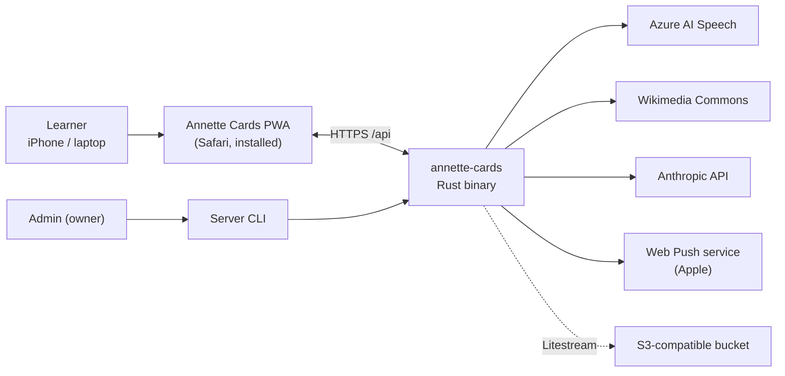
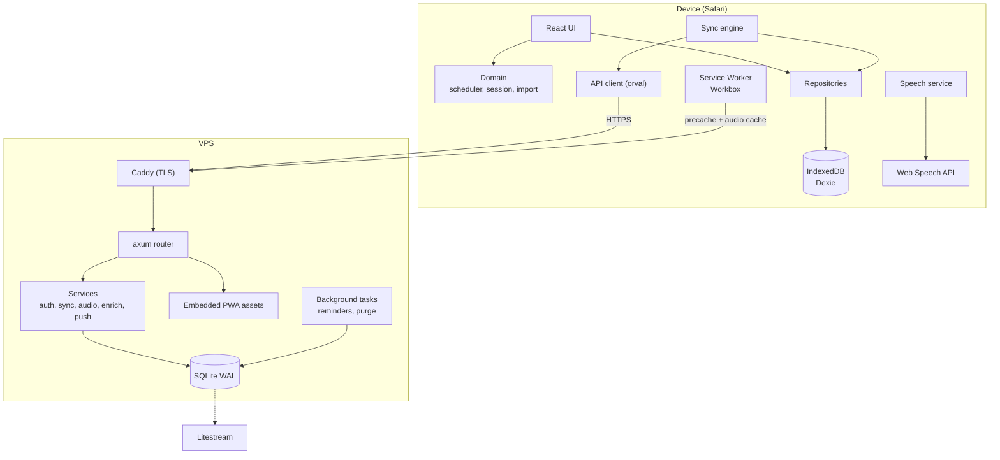
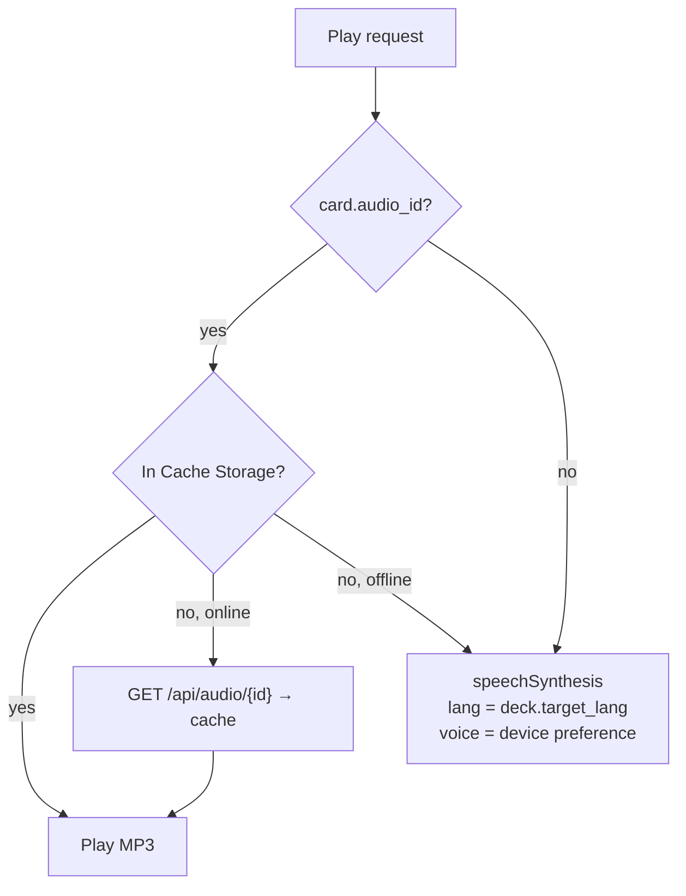
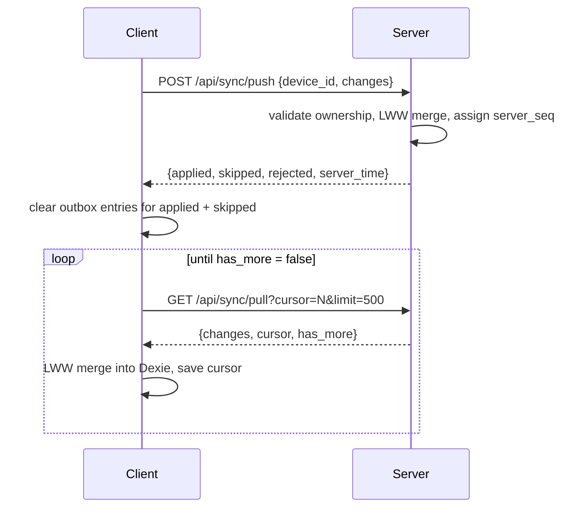
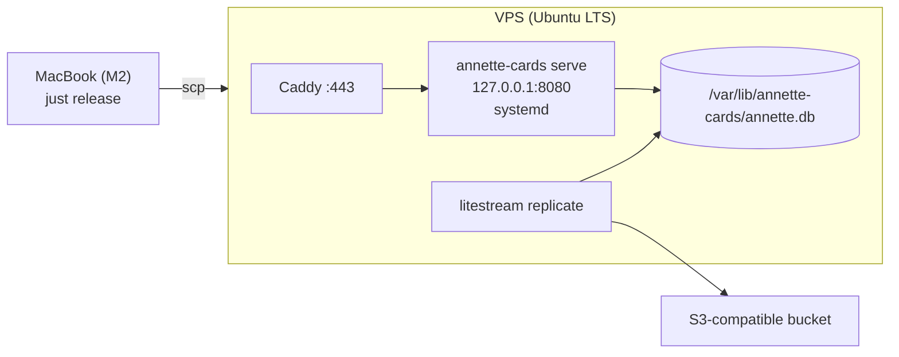

# Architecture

Annette Cards is an offline-first PWA backed by a single Rust binary with an embedded SQLite database. The client
owns the user experience and the scheduling logic; the server provides accounts, multi-device sync, audio
generation and AI enrichment.

## 1. Goals and constraints

| Goal | Consequence |
| --- | --- |
| Works on iPhone without network | Local IndexedDB is the primary store for the UI; FSRS runs on the client |
| Few users (owner + invited family/friends) | Invite-only accounts, SQLite, single process |
| Pronunciation quality matters | Layered audio: system voice → server-generated/recorded MP3 |
| Simple operations | One binary (API + PWA), one DB file, Litestream backups, Caddy for TLS |
| Backend is a Rust learning project | Mainstream crates, thin layers, explicit SQL |

Non-goals: public sign-up, real-time collaboration, shared decks between users (may come later), native iOS app.

## 2. System context



## 3. Containers



## 4. Client architecture

### 4.1 Layers

| Layer | Location | Responsibility | May depend on |
| --- | --- | --- | --- |
| UI | `src/features/*`, `src/components` | Screens, gestures, forms | Hooks, domain, repositories |
| Domain | `src/domain` | Pure logic: FSRS wrapper, session queue, answer checking, CSV parsing, normalization | Nothing app-specific |
| Repositories | `src/db` | Dexie schema, CRUD, transactions, outbox | Domain types |
| Sync engine | `src/features/sync` | Push/pull, conflict resolution, cursor | Repositories, API client |
| Platform services | `src/lib` | Speech, audio cache, storage persistence, i18n, device id | Browser APIs |
| API client | `src/api` (generated) | HTTP calls | — |

### 4.2 Local schema (Dexie)

```ts
db.version(1).stores({
  decks:        'id, updated_at, deleted_at',
  cards:        'id, deck_id, updated_at, deleted_at, *tags',
  card_states:  '[card_id+direction], card_id, due, state, updated_at',
  review_log:   'id, card_id, reviewed_at',
  settings:     'id',                  // single row 'user'
  outbox:       '++seq, [entity+entity_id]',
  meta:         'key',                 // device_id, sync_cursor, account info, last_sync_at
});
```

Device-local preferences (not synced): selected voice per language, speech rate, theme, audio prefetch flag.
They are stored in `meta` because voices differ between devices. `meta` keys (typed in `web/src/db/meta.ts`):
`device_id`, `sync_cursor` (`server_seq` of the last pulled row), `last_sync_at` (end of the last successful sync),
`sync_log` (the last 10 sync runs: start, end, status, pushed, pulled, rejected rows, error code), `clock_skew_ms`
(device minus server clock, stored while it exceeds 5 min), `account`, `voice_pref` (voice per language), `speech_rate`, `theme`,
`audio_prefetch` (download clips of active decks after each sync), `server_features` (`features` of the last
`GET /api/meta`, kept for offline use), `last_quick_add_deck` (deck preselected in Quick add), `extra_new` (`{ study_day, count }`,
extra new cards allowed today), `study_session` (snapshot of the current or last study session for resume within
30 min and the summary; `domain/studySession.ts`), `install_hint_shown` (the one-time iOS install hint was closed),
`storage_persisted` (answer of `navigator.storage.persist()`), `study_mode` (mode chip chosen on Today: `swipe`,
`choice`, `listening` or `typing`; kept on sign-out like the other device preferences), `onboarding_done` (first-run onboarding finished on
this device), `pending_account` (signed in, first-sync choice still open; §6.4), `account` (`{user_id, email, display_name, is_admin}` of the signed-in account, from login, register or
`GET /api/auth/me`; `features/auth/account.ts`), `session_expired` (the server answered 401 for the stored account:
S-15 shows "Sign in again", local data is kept). Writes to `meta` never create outbox entries.

`theme` (`system` | `light` | `dark`) is applied as `data-theme` on `<html>` (the `dark` variant in `index.css`;
`system` removes the attribute and follows `prefers-color-scheme`). Because IndexedDB is asynchronous, the value is
mirrored to `localStorage` (`annette.theme`) and applied by `public/theme.js`, a classic script in `<head>` that
runs before the first paint (a file, not an inline script, because of the CSP `default-src 'self'`).

### 4.3 Write path

Every mutation runs in a single Dexie `rw` transaction:

1. Validate input (domain).
2. Write the entity with `updated_at = now`, `updated_by = device_id`. The stamp is strictly later than this
   device's previous one (`now`, or previous + 1 ms), so two edits in the same millisecond never share a stamp;
   times inside the row (`reviewed_at`, `deleted_at`, due dates) use the real `now`.
3. Upsert an outbox entry `{entity, entity_id}` (deduplicated by compound index; `card_states` use
   `"<card_id>:<direction>"` as `entity_id`). An existing entry is replaced with a new `seq`, so a push already in
   flight cannot clear a later change.
4. Commit. `useLiveQuery` re-renders subscribed components.
5. Sync engine is notified (`db/changes.ts`, called by `mutate` after the commit; debounced 2 s) and syncs if the
   user is signed in and online.

Rows pulled from the server take another path (`db/remote.ts`): they are written with their own stamps, in one
transaction per page together with `sync_cursor`, never outboxed and never announced as local changes.

### 4.4 Study engine

**FSRS.** `ts-fsrs` with `enable_short_term = true` (learning/relearning steps), `request_retention` from settings
(default 0.90), `maximum_interval` 36500 days, fuzz enabled. Weights default to ts-fsrs defaults and can be
replaced by optimized weights (Phase 4).

**Directions.** Each card has up to two states: `forward` (see studied word → recall translation) and `reverse`
(see translation → recall studied word). The deck setting decides which directions are active. Every card write
creates a New state for each active direction that has none (`ensureStatesForCards` in `web/src/db/cardStates.ts`);
existing states are never reset. When a direction is switched off, its states are **kept** (hidden from study
queues, not deleted), so switching it back on restores the progress.

**Normalization for duplicates** (`domain/normalize.ts`, decision D10): `normalizeFront(front)` = Unicode NFC,
trim, lowercase, collapse internal whitespace to one space. Two cards in the same deck are duplicates when their
normalized fronts are equal (soft-deleted cards are ignored). Used by the card editor warning, Quick add and CSV
import. Typing-mode answer normalization (P4-T01) builds on it.

**Day boundary.** A "study day" starts at `day_start_hour` (default 04:00 local time). Daily limits and statistics
use study days. `domain/studyDay.ts` works on local calendar fields, so a DST change makes that study day 23 or 25
hours long instead of moving the boundary.

**Daily counters** (`domain/counters.ts`) come from the non-deleted review logs of the current study day: an answer
whose `state_before.state` is New counts as a new card introduced, every other answer as a review done.

**Session queue** (`domain/session.ts`):

0. Eligible: non-deleted card in a non-deleted, non-archived deck, direction active for the deck (optionally one
   deck only; the limits still count answers from all decks).
1. Collect due states: `due <= now` and state ∈ {Review, Relearning, Learning}, oldest `due` first, up to
   `max_reviews_per_day − reviews_done_today`.
2. Collect new states (state = New), ordered by card `created_at` (then id), within two limits: per deck
   `(deck.new_per_day ?? settings.new_per_day) + extra_new − new_introduced_today_in_deck`, and globally
   `settings.new_per_day + extra_new − new_introduced_today`. `extra_new` is the "Learn extra new words"
   allowance (+10 per tap, `meta.extra_new`, reset when the study day changes).
3. Interleave: one new card after every 4 reviews (configurable later).
4. **Bury siblings:** forward and reverse of the same card are not both shown in one study day: a direction is
   skipped when the other one was answered today or is already queued. Learning/Relearning states are never
   buried, so learning steps continue.
5. Learning steps: a card answered with a short next interval (< 20 min) is re-inserted into the current queue at
   its due time (about 10 s per card); if the session ends earlier, it remains due.

**Streak** (`domain/streak.ts`, decision D5). `studyDays(logs)` is the set of study days with at least one
non-undone answer (practice answers count). The current streak is the number of consecutive study days ending
today, or yesterday when nothing was answered yet today; the longest streak is the longest such run ever. Today
and Statistics use the same functions. Every moment is read in one time zone, the device's current one
(`studyDayOf(ms, dayStartHour, timeZone?)`), so moving to a nearby zone does not open a gap; only an answer
within the zone difference of the day boundary can move to a neighbouring day.

**Statistics** (`domain/stats.ts`, `db/stats.ts`, S-13). Computed on the device from Dexie, per study day. They
cover the active decks (not deleted, not archived; optionally one deck), like the study queue: states in active
directions and the answers to their cards (a deleted card's answers stay in the history). Retention = share of
Good + Easy among answers whose `state_before` is Review, practice answers excluded; young/mature split at a
Review interval of 21 days; the due forecast puts overdue states on today. Streaks always count every answer.

**Answer → rating mapping.**

| Mode | Input | FSRS rating |
| --- | --- | --- |
| Swipe (simple) | Swipe left / "Don't know" | Again |
| Swipe (simple) | Swipe right / "Know" | Good |
| Swipe (detailed) | Buttons Again / Hard / Good / Easy; swipe up = Easy | As chosen |
| Multiple choice | Wrong / correct | Again / Good |
| Listening | Wrong / correct | Again / Good |
| Typing | Exact (after normalization) | Good |
| Typing | Near miss (see below) | Hard |
| Typing | Otherwise | Again |

**Typing normalization and tolerance** (`domain/answer.ts`): `normalizeFront` (Unicode NFC, trim, lowercase,
collapse spaces), then the punctuation `. , ! ? ; : " ' « » ( )` stripped from both ends, and for answers typed in
English one leading `to`, `the` or `a` dropped (`"To take off!"` = `take off`). Near miss = Damerau–Levenshtein
distance (optimal string alignment: an adjacent transposition is one edit) ≤ 1 for answers up to 6 characters,
≤ 2 for longer (length of the normalized expected answer); or equal after stripping diacritics (NFD without
combining marks, plus `ł→l`, `ø→o`, `đ→d`; important for Polish: `zolw` vs `żółw`). A near miss shows a letter
diff: missing and extra letters, and the correct letter where only its diacritic was missing.

Expected answers per direction: *reverse* (prompt = translation) expects the card front, typed in the deck's
`target_lang`; *forward* (prompt = studied word) accepts any `;`-separated meaning of the card back, typed in
`native_lang`. The answer is logged with `mode = 'typing'` when Continue is tapped (or after the exact-answer
auto-advance), with `duration_ms` measured up to Check.

**Answer transaction** (`db/study.ts`). Compute `fsrs.next(state, now, rating)`; in one Dexie transaction update
`card_states`, append `review_log` (with previous state snapshot for undo), add outbox entries. `duration_ms` is the
time from the card being shown to the answer, capped at 60 s (a phone put down mid-card does not inflate the time
spent).

**Undo.** Only the last answer in the current session: restore the previous state snapshot (stamped with a new
`updated_at`, so it wins last-write-wins) and soft-delete the log entry (`deleted_at`). An answer that is not the
latest non-deleted log is refused with `undo_not_last`.

**Practice mode** (UC-16, `domain/practice.ts`). The queue holds studied directions with lapses ≥ 3 or stability
< 2 days, plus the cards failed in the last session; most lapses first, at most 50. Every practice answer is
logged with `practice = true`. "Repeat these now" (S-12) practices only the cards failed in that session. A card
that is not due yet keeps its FSRS state (only the log is written); a due card is scheduled normally. Practice
logs, like undone (soft-deleted) logs, are excluded from the daily counters.

### 4.5 Speech and audio



- Voice list is loaded via `speechSynthesis.getVoices()` plus the `voiceschanged` event (wait at most 3 s when the
  first list is empty; refreshed when the app becomes visible again); the preferred voice per language is stored per
  device (`meta.voice_pref`). If none is chosen, the best available voice is used (`lib/speech/voices.ts`): the
  exact locale before other regions of the same language (`en-GB` before `en-US`; `en_GB` is accepted), then
  Premium > Enhanced > default, detected from the voice name or URI ("(Premium)", `com.apple.voice.premium.…`,
  `…enhanced…`), then the system default voice. Rate is device-local (`meta.speech_rate`, 0.5–1.2, default 1.0);
  "Play slower" in listening mode plays one time at 0.7 (speech rate, or MP3 `playbackRate`).
- `lib/speech/speech.ts` exposes `speak(text, { lang, rate, voiceURI })` (synchronous up to
  `speechSynthesis.speak`, so tap handlers keep their gesture) and the `Speaker` interface
  `play(card, lang, 'front' | 'example')`. Phase 1 uses the system-voice speaker; P3-T03 puts a speaker for cached
  server audio (`card.audio_id`) in front of it and falls back to the system one.
- Autoplay in study (`shouldSpeak`): `front` speaks the studied word when a forward card is shown;
  `front_and_back` also speaks it when a reverse card is turned to its answer. The native-language side is never
  spoken. A `not-allowed` error (no gesture yet) makes the card's speaker icon pulse; a tap plays.
- The first utterance must follow a user gesture; the study screen starts with a "Start" tap for this reason.
- `utterance.lang` is always set explicitly (`en-GB`, `en-US`, `pl-PL`).
- Example sentences can be spoken too (tap on the example).
- **Server audio** (P3-T03, `lib/audio/`): `useSpeech().speaker` is `audioSpeaker(systemSpeaker)`. For a card with
  `audio_id`, `playCardAudio` takes the clip from Cache Storage (`audio-v1`, key `/api/audio/{id}`), else downloads
  it while online (`fetch` with `credentials: 'same-origin'`; a 200 answer is put into the cache) and plays it through
  one reused `<audio>` element from a blob URL (hence `media-src 'self' blob:` in the CSP, §9). No clip (offline and
  not cached, 404, network error) or a refused `play()` → the system voice. Examples always use the system voice.
  iOS: the study Start tap and every speaker tap call `unlockAudio()` synchronously (the element plays a 50 ms silent
  WAV inside the gesture), so autoplayed clips may play later without a gesture.
- **Source and attribution** come from the clip's response headers (`X-Audio-Source`, percent-encoded
  `X-Audio-Attribution`, §5.3), so a cached clip carries them offline. Settings → About lists the attributions of the
  cached recordings (`cachedAudioInfo()`).
- **Attach / remove** (S-07): the device first pushes unsynced edits of the card (so the server's edit does not
  overwrite them), calls `POST`/`DELETE /api/cards/{id}/audio`, then writes the new `audio_id` with
  `applyServerAudio(cardId, audioId)` — no stamp and no outbox entry, because the server already stamped and versioned
  the edit (§7) and a push of it would only race that version; the next pull (started right away) brings the server's
  row. A new clip is cached and played once.
- **Prefetch** (device-local `meta.audio_prefetch`, Settings → Audio, default off): after each successful sync
  (`onSyncFinished` in the engine), clips of cards with `audio_id` in decks that are neither deleted nor archived and
  not yet cached are downloaded, two at a time; it stops when the connection is lost.
- **Feature flags:** `useServerFeatures()` reads `GET /api/meta` (TanStack Query, when online) and keeps `features` in
  `meta.server_features`, so buttons of disabled features stay hidden offline too (`undefined` while the stored value
  is read, `null` before the server ever answered). Quick add renders once the account and the features are read,
  so the first Enter already knows whether to ask for AI suggestions.
- **Enrichment** (UC-09): `useEnrich()` wraps `POST /api/enrich` in a TanStack mutation (no retries; the request is
  aborted on unmount or when a new one starts). Suggestions are only held in component state (ghosts in S-08, the
  suggestion card in S-09); a card is written only by Save, through `createCard`/`updateCard` like any edit. The
  pure comparison of suggestions with filled fields (`empty-fill` / `conflict` / `same`, "Accept all") lives in
  `domain/enrich.ts`.

### 4.6 Internationalization

- `react-i18next` with `en.json` and `ru.json`; Russian plural forms via i18next plural suffixes.
- Initial UI language: settings value, else `navigator.language` starting with `ru` → Russian, else English. The
  settings document stores only fields that were set (defaults are merged on read), so `ui_language` is present
  only after the learner chose a language; until then the device's detection applies. The last language is also
  cached in `localStorage` (`annette.uiLanguage`) for the first render.
- Server errors are codes; the client maps them to translation keys (`errors.<code>`, `lib/apiErrors.ts`; an unknown
  code shows `errors.unknown`, an unreachable server `errors.network`). UI code calls the generated client through
  `callApi` (`lib/api.ts`), which returns the data of a 2xx response and throws `ApiError { status, code }`
  otherwise. Only auth, admin invites, server metadata, the sync engine, audio (§4.5) and enrichment
  (`features/enrich/useEnrich`, §8) call the API.
- Dates and numbers via `Intl` with the UI locale.

### 4.7 PWA

| Aspect | Decision |
| --- | --- |
| Manifest | `display: standalone`, theme colors for light/dark, maskable icons |
| iOS meta | `apple-touch-icon`, `apple-mobile-web-app-capable`, `apple-mobile-web-app-status-bar-style` |
| Service worker | Our own `src/sw.ts`, built by vite-plugin-pwa with `injectManifest` (P4-T04: `generateSW` cannot add push handlers); type-checked with the WebWorker library (`tsconfig.sw.json`) |
| Precache | App shell via Workbox: `index.html`, JS (incl. the CSV import worker; routes are not lazy-loaded), CSS, `theme.js`, icons, manifest; `navigateFallback: /index.html` so every route opens offline. Verified by `web/tests/e2e/offline.spec.ts` against the production build |
| Runtime caching | `/api/audio/*` CacheFirst (`audio-v1`, max 5000 entries, only 200 answers; matched by path, since Workbox tests a RegExp against the whole URL); other `/api/*` NetworkOnly. The app writes the same cache when it downloads a clip; "Clear cached audio" (Settings → Data) deletes it, sign-out too |
| Updates | `registerType: 'prompt'` → in-app banner "New version available — Reload" (the banner posts `SKIP_WAITING` to the waiting worker) |
| Reminders | `push`: a `{ "type": "reminder", "due": n }` payload becomes a notification in the UI language (`ui_language` of the settings row read with plain IndexedDB, else the device language), text from `notifications.reminder` of the bundled `en.json`/`ru.json` with `Intl.PluralRules`; tag `reminder`, so a new one replaces an unread one. Other payloads are ignored. `notificationclick`: focuses an open window and sends it `open-today` (the app navigates to Today), otherwise opens `/` |
| Storage | `navigator.storage.persist()` on first run; show a warning if denied and the user is not signed in |
| Install hint | If not `standalone` on iOS, show a one-time "Add to Home Screen" guide |

## 5. Server architecture

### 5.1 Modules

| Module | Responsibility |
| --- | --- |
| `main.rs` | CLI (`clap`): `serve`, `create-user`, `invite`, `openapi`, `purge` |
| `config.rs` | Typed config from env (`figment`) |
| `app.rs` | `AppState` (pool, config, providers), router assembly, middleware |
| `error.rs` | `AppError` → HTTP status + `{ "code": "...", "details": ... }` |
| `db.rs` | Pool creation, pragmas, migrations |
| `clock.rs` | `now_ms()` and the ms constants used for timestamps |
| `auth/` | Login, logout, sessions, `CurrentUser` extractor, password change (SQL for `users` and `sessions` in `users.rs`, `session.rs`) |
| `sync/` | Push/pull services, LWW merge (`lww.rs`), row validation (`validate.rs`), ownership checks, `server_seq` allocation (`seq.rs`) |
| `audio/` | `TtsProvider` trait (Azure impl), Commons lookup, `audio_assets` storage and serving |
| `enrich/` | `Enricher` trait (Anthropic impl), prompt, JSON validation, daily quota |
| `push/` | Web Push subscriptions, VAPID, reminder task |
| `fsrs/` | Weight optimization from review logs (Phase 4) |
| `admin/` | Invite management (CLI + admin-only endpoints); the invite code generator |
| `security.rs` | Origin check, per-IP rate limits, security headers, request ids |
| `static_files.rs` | Serve embedded PWA with SPA fallback and cache headers |

### 5.2 Request pipeline

`Caddy (TLS)` → request id (`x-request-id`, UUIDv7; kept if the proxy set one; echoed in the response) →
`TraceLayer` → security headers → `CompressionLayer` → `TimeoutLayer (30 s)` → origin check for unsafe methods →
rate limiter (route-specific) → handler → service → sqlx. In debug builds a permissive `CorsLayer` wraps everything.
The layers are assembled in `app.rs` (`router`), the security pieces live in `security.rs`.

- **Origin check** (`security::check_origin`): POST, PUT, PATCH and DELETE under `/api` need an `Origin` header
  equal to `ANNETTE_PUBLIC_URL` (or, with `ANNETTE_DEV_ORIGINS`, the Vite dev server on port 5173);
  otherwise 403 `origin_mismatch`.
- **Rate limits** (`security::limit_per_ip`): a token bucket per client IP (`X-Forwarded-For` from Caddy, else the
  TCP peer). `POST /api/auth/login` and `/api/auth/register` share 10 requests per minute (burst 10, one more
  every 6 s); over the limit → 429 `rate_limited` with `Retry-After`. Audio and enrich reuse the same function
  with their own limits.

### 5.3 API

All endpoints are under `/api`, JSON, timestamps in ms since epoch. Auth = session cookie `ac_session`.

| Method | Path | Auth | Purpose |
| --- | --- | --- | --- |
| GET | `/api/health` | no | Liveness + DB ping |
| GET | `/api/meta` | no | Server version, enabled features (`tts`, `commons`, `enrich`, `push`) |
| POST | `/api/auth/register` | no | Create account with invite code |
| POST | `/api/auth/login` | no | Email + password → session cookie |
| POST | `/api/auth/logout` | yes | Revoke current session |
| POST | `/api/auth/logout-others` | yes | Revoke all other sessions |
| GET | `/api/auth/me` | yes | Current user profile |
| POST | `/api/auth/password` | yes | Change password |
| POST | `/api/sync/push` | yes | Upload local changes |
| GET | `/api/sync/pull?cursor=&limit=` | yes | Download changes after cursor |
| GET | `/api/sync/summary` | yes | Counts of non-deleted decks and cards, for the first sign-in choice (S-03) |
| POST | `/api/cards/{id}/audio` | yes | Generate/fetch audio (`source`: `tts` \| `commons`) |
| DELETE | `/api/cards/{id}/audio` | yes | Remove audio from card |
| GET | `/api/audio/{id}` | yes | MP3 bytes, `Cache-Control: private, max-age=31536000, immutable` |
| POST | `/api/enrich` | yes | Suggest back, example, example_translation, ipa, notes |
| GET | `/api/export` | yes | Full JSON export of the user's data |
| POST | `/api/import/json` | yes | Restore a JSON export into the account (empty account only) |
| POST | `/api/push/subscribe` | yes | Store Web Push subscription |
| DELETE | `/api/push/subscribe` | yes | Remove subscription |
| POST | `/api/fsrs/optimize` | yes | Fit FSRS weights from review log (Phase 4) |
| GET/POST/DELETE | `/api/admin/invites` | admin | List, create, revoke invites |
| GET | `/api/openapi.json` | no | OpenAPI spec |

**Push subscriptions** (P4-T04). `POST /api/push/subscribe` takes the browser's `PushSubscription.toJSON()`
without `expirationTime`: `{ "endpoint": "https://web.push.apple.com/…", "keys": { "p256dh": "…", "auth": "…" } }`
→ 204. The endpoint must be `https` on a known push service (`push.apple.com`, `fcm.googleapis.com`,
`push.services.mozilla.com`, `notify.windows.com`, or a subdomain), `p256dh` 65 bytes and `auth` 16 bytes of
base64url, else 400 `validation_failed`. The row is upserted by endpoint: the same endpoint from another account moves
to the current user. `DELETE /api/push/subscribe { "endpoint": "…" }` → 204, or 404 `not_found` when the current user
has no such subscription. Both answer 409 `push_disabled` without VAPID keys. `GET /api/meta` adds
`vapid_public_key` (base64url, `null` when push is off) for `pushManager.subscribe`.

Error response: `{ "code": "invalid_credentials", "details": null }` with the appropriate HTTP status. A request
body that is not valid JSON of the expected shape is 400 `validation_failed`; a body over the route's limit is 413
`payload_too_large` (`json::AppJson`).

**Auth DTOs.** `POST /api/auth/login` takes `{email, password, device_label?}` and returns `MeResponse`
`{id, email, display_name, is_admin, created_at}` with the `ac_session` cookie (`HttpOnly; Secure; SameSite=Strict;
Path=/; Max-Age` = session TTL). `GET /api/auth/me` returns `MeResponse` and re-sends the cookie with a fresh
`Max-Age`, so the browser keeps the sliding session as long as the server does. `POST /api/auth/password` takes
`{current_password, new_password}`. Logout, logout-others and password change return 204; logout also clears the
cookie (`Max-Age=0`). Endpoints marked "yes" accept only a valid, unexpired session; the server extends a session's
expiry to now + TTL at most once an hour (on the first request an hour after the last extension).

**Auth error codes.**

| Code | Status | When |
| --- | --- | --- |
| `invalid_credentials` | 401 | Login with an unknown email or a wrong password (same code and similar timing for both) |
| `invalid_credentials` | 400 | Password change with a wrong current password |
| `password_too_short` | 400 | New password shorter than 10 characters |
| `validation_failed` | 400 | Malformed email or display name |
| `unauthorized` | 401 | Missing, unknown or expired session cookie |
| `forbidden` | 403 | Signed in but not an admin (admin endpoints) |
| `invite_invalid` | 400 | Register with an unknown or already used invite code |
| `invite_expired` | 400 | Register with an expired invite code |
| `email_taken` | 409 | Register with an email that has an account (letter case ignored) |
| `invite_used` | 409 | Revoke an invite that was already used |
| `origin_mismatch` | 403 | Unsafe request without this site's `Origin` |
| `rate_limited` | 429 | More than 10 login/register attempts a minute from one IP |
| `payload_too_large` | 413 | Body over the route's limit (push 2 MB, restore 20 MB) |
| `account_not_empty` | 409 | Restore into an account that has decks |
| `unsupported_version` | 400 | Restore of a backup written by a newer app |
| `invalid_format` | 400 | Restore of something that is not a valid backup |

**Register.** `POST /api/auth/register` takes `{invite_code, display_name, email, password, device_label?}` and
answers like login (`MeResponse` + cookie). The code is matched case-insensitively. Display name: 1–100
characters after trimming. The invite check, the new user, marking the invite used and the session are one
transaction (`BEGIN IMMEDIATE`), so a failed registration leaves the invite usable.

**Audio** (§7):

- `POST /api/cards/{id}/audio` takes `{source: "tts" | "commons", voice?}` (voice: letters, digits, `-`, `:`) and
  returns `{audio_id, attribution}`.
- `GET /api/audio/{id}` returns the clip (`Content-Type` from the asset, `Cache-Control: private, max-age=31536000,
  immutable`) with `X-Audio-Source: azure | commons` and, when known, `X-Audio-Attribution` (author and license,
  percent-encoded UTF-8; decode with `decodeURIComponent`). A cached clip thus carries its attribution to devices
  that only received `audio_id` through sync. Another user's clip is 404 `not_found`.

| Code | Status | When |
| --- | --- | --- |
| `not_found` | 404 | The card (or clip) does not exist, is deleted or belongs to another user; or Commons has no recording of the word |
| `tts_disabled` | 409 | `source: "tts"` on a server without TTS settings |
| `unsupported_language` | 400 | No voice for the deck's language and no `voice` given |
| `commons_disabled` | 409 | `source: "commons"` with `ANNETTE_COMMONS_ENABLED=false` |
| `provider_error` | 502 | The TTS provider or Wikimedia failed or could not be reached |
| `rate_limited` | 429 | More than 60 audio requests in an hour |

**Enrichment** (§8):

- `POST /api/enrich` takes `{front, target_lang, native_lang, context?}` (front 1–500 characters after trimming,
  context ≤ 500, languages BCP-47 tags) and returns `{back, example, example_translation, ipa, notes}`; only `back`
  is always set, the others may be `null`. Nothing is stored except the usage count.

| Code | Status | When |
| --- | --- | --- |
| `validation_failed` | 400 | Empty or too long `front`/`context`, or a language that is not a BCP-47 tag |
| `enrich_disabled` | 409 | No `ANTHROPIC_API_KEY` on the server |
| `enrich_quota_exceeded` | 429 | The user's daily quota (`ANNETTE_ENRICH_DAILY_LIMIT`) is used up; it resets at 00:00 UTC |
| `rate_limited` | 429 | More than 20 enrich requests a minute |
| `provider_error` | 502 | The model failed, could not be reached or gave no valid suggestion twice |
| `provider_timeout` | 504 | The model did not answer within 10 s |

**Export and restore** (backup format §6.5):

- `GET /api/export` → the backup JSON with `Content-Disposition: attachment;
  filename="annette-export-YYYY-MM-DD.json"` (UTC date). `app_version` is the server version.
- `POST /api/import/json` with a backup as the body (limit 20 MB) → `{decks, cards, card_states, review_log}` counts
  of written rows. Only into an account without non-deleted decks, else 409 `account_not_empty`. A newer `version`
  → 400 `unsupported_version`; no format marker, a row of the wrong shape, a reference outside the file or a row
  the push validation refuses → 400 `invalid_format`, and nothing is written. Rows get new UUIDv7 ids (references
  follow), `updated_at = now` and `updated_by = "server-import"`, and go through the push insert path with its
  checks, in one transaction; every device then pulls them.
- `GET /api/sync/summary` → `{decks, cards}`: decks with `deleted_at IS NULL`, and cards with `deleted_at IS NULL`
  in such decks.

**Admin invites** (admin session required; others get 403 `forbidden`):

- `GET /api/admin/invites` → `[{code, note, expires_at, used_by_email, used_at, status}]`, newest expiry first;
  `status` is `active` | `used` | `expired`, computed by the server.
- `POST /api/admin/invites` `{note?, days?}` (days 1–90, default 7; note ≤ 200 characters) → 201 with the same
  shape. The CLI `invite` subcommand uses the same function (`admin::invites::create_invite`).
- `DELETE /api/admin/invites/{code}` → 204 (the row is deleted; invites are not synced); used → 409
  `invite_used`; unknown → 404 `not_found`.

### 5.4 Server data model (SQLite)

All synced tables carry `user_id`, `updated_at`, `updated_by`, `deleted_at`, `server_seq`.

```sql
CREATE TABLE users (
  id            TEXT PRIMARY KEY,
  email         TEXT NOT NULL UNIQUE COLLATE NOCASE,
  display_name  TEXT NOT NULL,
  password_hash TEXT NOT NULL,
  is_admin      INTEGER NOT NULL DEFAULT 0,
  created_at    INTEGER NOT NULL
);

CREATE TABLE invites (
  code        TEXT PRIMARY KEY,           -- random, 12 chars
  created_by  TEXT NOT NULL REFERENCES users(id),
  note        TEXT,
  expires_at  INTEGER NOT NULL,
  used_by     TEXT REFERENCES users(id),
  used_at     INTEGER
);

CREATE TABLE sessions (
  token_hash   TEXT PRIMARY KEY,          -- sha256 of the cookie value
  user_id      TEXT NOT NULL REFERENCES users(id) ON DELETE CASCADE,
  device_label TEXT,
  created_at   INTEGER NOT NULL,
  last_seen_at INTEGER NOT NULL,
  expires_at   INTEGER NOT NULL
);

CREATE TABLE sync_seq (id INTEGER PRIMARY KEY CHECK (id = 1), value INTEGER NOT NULL);

CREATE TABLE decks (
  id           TEXT PRIMARY KEY,
  user_id      TEXT NOT NULL REFERENCES users(id),
  name         TEXT NOT NULL,
  target_lang  TEXT NOT NULL,             -- BCP-47, e.g. en-GB, pl-PL
  native_lang  TEXT NOT NULL,             -- e.g. ru
  directions   TEXT NOT NULL,             -- 'forward' | 'reverse' | 'both'
  new_per_day  INTEGER,                   -- NULL = global setting
  archived_at  INTEGER,
  created_at   INTEGER NOT NULL,
  updated_at   INTEGER NOT NULL,
  updated_by   TEXT NOT NULL,
  deleted_at   INTEGER,
  server_seq   INTEGER NOT NULL
);

CREATE TABLE cards (
  id                  TEXT PRIMARY KEY,
  user_id             TEXT NOT NULL REFERENCES users(id),
  deck_id             TEXT NOT NULL REFERENCES decks(id),
  front               TEXT NOT NULL,
  back                TEXT NOT NULL,
  example             TEXT,
  example_translation TEXT,
  ipa                 TEXT,
  tags                TEXT NOT NULL DEFAULT '[]',   -- JSON array
  notes               TEXT,
  audio_id            TEXT,
  created_at          INTEGER NOT NULL,
  updated_at          INTEGER NOT NULL,
  updated_by          TEXT NOT NULL,
  deleted_at          INTEGER,
  server_seq          INTEGER NOT NULL
);

CREATE TABLE card_states (
  card_id        TEXT NOT NULL REFERENCES cards(id),
  direction      TEXT NOT NULL,           -- 'forward' | 'reverse'
  user_id        TEXT NOT NULL REFERENCES users(id),
  state          INTEGER NOT NULL,        -- 0 New, 1 Learning, 2 Review, 3 Relearning
  due            INTEGER NOT NULL,
  stability      REAL NOT NULL,
  difficulty     REAL NOT NULL,
  elapsed_days   INTEGER NOT NULL,
  scheduled_days INTEGER NOT NULL,
  learning_steps INTEGER NOT NULL,
  reps           INTEGER NOT NULL,
  lapses         INTEGER NOT NULL,
  last_review    INTEGER,
  updated_at     INTEGER NOT NULL,
  updated_by     TEXT NOT NULL,
  deleted_at     INTEGER,
  server_seq     INTEGER NOT NULL,
  PRIMARY KEY (card_id, direction)
);

CREATE TABLE review_log (
  id           TEXT PRIMARY KEY,
  user_id      TEXT NOT NULL REFERENCES users(id),
  card_id      TEXT NOT NULL REFERENCES cards(id),
  direction    TEXT NOT NULL,
  rating       INTEGER NOT NULL,          -- 1 Again, 2 Hard, 3 Good, 4 Easy
  mode         TEXT NOT NULL,             -- 'swipe' | 'choice' | 'listen' | 'typing'
  state_before TEXT NOT NULL,             -- JSON snapshot (for undo / rebuild)
  reviewed_at  INTEGER NOT NULL,
  duration_ms  INTEGER NOT NULL,
  practice     INTEGER NOT NULL DEFAULT 0, -- 1 = answered in practice mode (UC-16, decision D2)
  updated_at   INTEGER NOT NULL,
  updated_by   TEXT NOT NULL,
  deleted_at   INTEGER,
  server_seq   INTEGER NOT NULL
);

CREATE TABLE user_settings (
  user_id     TEXT PRIMARY KEY REFERENCES users(id),
  data        TEXT NOT NULL,              -- JSON, see 5.5
  updated_at  INTEGER NOT NULL,
  updated_by  TEXT NOT NULL,
  server_seq  INTEGER NOT NULL
);

CREATE TABLE audio_assets (
  id          TEXT PRIMARY KEY,
  user_id     TEXT NOT NULL REFERENCES users(id),
  card_id     TEXT NOT NULL REFERENCES cards(id),
  source      TEXT NOT NULL,              -- 'azure' | 'commons'
  mime        TEXT NOT NULL,              -- 'audio/mpeg'
  voice       TEXT,
  attribution TEXT,                       -- author + license for Commons
  bytes       BLOB NOT NULL,
  created_at  INTEGER NOT NULL
);

CREATE TABLE push_subscriptions (
  id         TEXT PRIMARY KEY,
  user_id    TEXT NOT NULL REFERENCES users(id),
  endpoint   TEXT NOT NULL UNIQUE,
  p256dh     TEXT NOT NULL,
  auth       TEXT NOT NULL,
  created_at INTEGER NOT NULL
);

CREATE TABLE enrich_usage (
  user_id TEXT NOT NULL REFERENCES users(id),
  day     TEXT NOT NULL,                  -- YYYY-MM-DD (UTC)
  count   INTEGER NOT NULL,
  PRIMARY KEY (user_id, day)
);

CREATE INDEX idx_decks_user_seq        ON decks(user_id, server_seq);
CREATE INDEX idx_cards_user_seq        ON cards(user_id, server_seq);
CREATE INDEX idx_states_user_seq       ON card_states(user_id, server_seq);
CREATE INDEX idx_states_user_due       ON card_states(user_id, due);
CREATE INDEX idx_log_user_seq          ON review_log(user_id, server_seq);
CREATE INDEX idx_log_user_reviewed     ON review_log(user_id, reviewed_at);
CREATE INDEX idx_push_subscriptions_user ON push_subscriptions(user_id);
```

### 5.5 Settings document

```json
{
  "ui_language": "ru",
  "day_start_hour": 4,
  "new_per_day": 15,
  "max_reviews_per_day": 200,
  "answer_mode": "simple",
  "desired_retention": 0.9,
  "fsrs_weights": null,
  "autoplay": "front",
  "reminder": { "enabled": false, "time": "20:00", "tz": "Europe/Riga" },
  "default_directions": "both",
  "show_ipa_on_front": true,
  "listening_answer": "choose"
}
```

- `answer_mode`: `simple` | `detailed`; `autoplay`: `off` | `front` | `front_and_back` (UI: Off / Front / Front and answer).
- `default_directions` (`forward` | `reverse` | `both`): directions preselected for a new deck.
- `show_ipa_on_front`: show the IPA with the studied word on the front of a study card.
- Missing fields fall back to these defaults (`web/src/domain/settings.ts`), so older documents stay valid.

## 6. Synchronization protocol

### 6.1 Principles

- Client is authoritative for its own edits; server is the rendezvous point.
- **Cursor** = server-assigned monotonic `server_seq` (global counter in `sync_seq`), never client clocks.
- **Conflict resolution** for mutable rows: last-write-wins by `(updated_at, updated_by)` — the larger
  `updated_at` wins; ties broken by lexicographically larger `updated_by`.
- `review_log` is append-only and idempotent by `id`; only `deleted_at` may change (undo).
- Soft deletes propagate like any other change. A deleted deck implies its cards are hidden on both sides; the
  client also marks the cards and their states deleted, in the same transaction and with the same `deleted_at`
  (which lets "Undo" restore exactly those rows).
- Clock skew risk is accepted for a personal app; the client warns if `|server_time − device_time| > 5 min`.

### 6.2 Sequence



### 6.3 Payloads

```json
// POST /api/sync/push
{
  "device_id": "0192f6c1-...",
  "changes": {
    "decks":       [{ "id": "...", "name": "English B2", "target_lang": "en-GB", "native_lang": "ru",
                      "directions": "both", "new_per_day": null, "archived_at": null,
                      "created_at": 1758441600000, "updated_at": 1758441600000,
                      "updated_by": "0192f6c1-...", "deleted_at": null }],
    "cards":       [],
    "card_states": [],
    "review_log":  [],
    "settings":    null
  }
}

// response
{
  "applied":  { "decks": ["..."], "cards": [], "card_states": [], "review_log": [], "settings": false },
  "skipped":  { "decks": [], "cards": ["..."], "card_states": [], "review_log": [], "settings": false },
                                              // server version won LWW (or was identical); client gets it on pull
  "rejected": [{ "entity": "cards", "id": "...", "code": "deck_not_owned" }],
  "server_time": 1758441601234
}

// GET /api/sync/pull?cursor=1200&limit=500
{
  "changes": { "decks": [], "cards": [], "card_states": [], "review_log": [], "settings": null },
  "cursor": 1340,
  "has_more": false
}
```

`review_log` rows carry `practice` (boolean in JSON, `0/1` in SQLite; decision D2). `settings` is
`{ "data": { …§5.5, only the fields that were set… }, "updated_at": …, "updated_by": "…" }` or `null`. A card state
is named `"{card_id}:{direction}"` in `applied`, `skipped` and `rejected`; settings as `"settings"`.

**Pull** returns up to `limit` (default 500, clamped to 1–1000) of the user's rows with `server_seq > cursor`, across
all entities in `server_seq` order, soft-deleted rows included; `settings` is the settings row if it changed
after the cursor. `cursor` in the response is the largest `server_seq` returned (the request's cursor when the page
is empty); `has_more` means another page follows. An updated row comes again with its new `server_seq`, once.

**Client engine** (`features/sync/`): `syncNow(reason)` runs one sync at a time (a call during a run schedules one
more run). A run needs an account, a valid session and a connection, then:

1. **Push** the whole outbox, sorted by entity (decks → cards → card states → review log → settings) and cut into
   requests of at most 500 rows, so a card whose deck was edited later (and sits later in the outbox) is never sent
   before its deck. After each answer the sent outbox entries are removed if they still have the `seq` that was
   sent: applied and skipped rows are on the server (skipped ones come back on pull), rejected rows would be refused
   again and go to the sync log instead. A row edited during the request has a new entry and is sent in the next
   round (up to 5 rounds). The first request is made even with an empty outbox: its `server_time` is compared with
   the device clock (warning in S-15 when they differ by more than 5 min).
2. **Pull** pages of 500 from `sync_cursor` until `has_more` is false; each page is merged by LWW and the cursor
   saved in one transaction.
3. Cards still alive in a deck that arrived deleted (added here or on a third device before the deletion arrived)
   are deleted like a local deck deletion would, as local writes that the next push sends.
4. `last_sync_at` and a sync log entry are written. HTTP 401 marks the session expired and stops syncing until the
   user signs in again; other errors are logged and retried after 5 s, 10 s, 20 s … up to 5 min.

Triggers: app start, `visibilitychange` to visible, `online`, 2 s after the last local change, "Sync now" in S-15,
pull-down on Today, and sign-in.

Push is processed in one SQLite transaction (`BEGIN IMMEDIATE`) per request. Entities are applied in dependency
order: decks → cards → card_states → review_log → settings, so a card may reference a deck from the same batch.
Every applied row gets `user_id` from the session (a client value is ignored) and a new `server_seq`. Per row:

- **Mutable rows** (decks, cards, card states, settings): inserted if new; replaced if the incoming stamp wins LWW
  (§6.1); otherwise `skipped`. A soft delete is an ordinary update.
- **`review_log`**: inserted if the id is new. For a known id only a first `deleted_at` (undo) is taken over, with
  its stamp → `applied`; anything else → `skipped`; other fields never change.
- **Rejected** rows (`{entity, id, code}`) are left out; the rest of the batch still applies. Codes:
  `validation_failed` (limits below), `not_owned` (the id belongs to another user), `deck_not_owned` (a card's
  deck is not the user's or does not exist), `card_not_owned` (same for a state's or log's card).

Row limits match the client: deck name ≤ 100 and languages ≤ 35 characters; front/back 1–500; example and its
translation ≤ 2000; IPA ≤ 200; notes ≤ 2000; each tag 1–50; ids and `updated_by` ≤ 100; `state` 0–3; `rating`
1–4; `state_before` a JSON object; settings `data` a JSON object ≤ 16 KiB. Whole-request errors: more than 500 rows
→ 400 `validation_failed`; body over 2 MB → 413 `payload_too_large`; malformed JSON → 400 `validation_failed`.

### 6.4 Triggers and first sign-in

- Sync runs on app start, on `visibilitychange` to visible, on `online`, 2 s after local changes (debounced),
  and via a manual button.
- **After every sign-in or registration** the client opens S-03 (`/first-sync`, `features/sync/firstSync.ts`). The
  signed-in account waits in `meta.pending_account`; it becomes `meta.account` (which lets the engine sync) only
  once the first sync is settled, so nothing is pushed before the user chose. *Local data* = at least one deck that
  is not deleted.
  - This device already synced with this account (`sync_cursor` set and the same `user_id`, e.g. "Sign in again"
    after the session expired) → normal sync.
  - Otherwise the client asks `GET /api/sync/summary` for the account's counts:
    - no local data → leftovers are wiped (e.g. a UI language picked during onboarding would otherwise replace the
      account's whole settings document), then pull;
    - local data and an empty account (`decks = 0`) → every local row is queued once (`enqueueAll`), pushed, then
      pulled;
    - both non-empty → S-03 shows both counts and the user chooses *Merge* (queue every local row, push, pull),
      *Use account data* (after a confirm sheet: wipe local data, pull) or *Cancel* (`POST /api/auth/logout`,
      local data untouched).
  - A progress bar shows rows sent and received against an estimate (rows to push, plus the account's decks and
    three rows per card); it stays below 100 % until the sync ends. Then Today opens (onboarding if the device is
    still empty).
- **Sign-out** (S-15): with unsynced changes and a connection the client syncs first; if changes remain (or it is
  offline) a confirm sheet shows their count ("Sign out anyway" / "Cancel"). Then it stops syncing, calls
  `POST /api/auth/logout` (a network failure is ignored), wipes local data and deletes Cache Storage except the
  service worker's precache (so the app still opens offline), and opens onboarding.
- **Wipe** (`db/localData.ts`, sign-out and *Use account data*): clears decks, cards, states, reviews, settings and
  the outbox, and every `meta` key except the device-local preferences `theme`, `voice_pref`, `speech_rate`,
  `audio_prefetch`, `server_features`, `study_mode`, `install_hint_shown` and `storage_persisted`. `device_id` is removed too, so the device writes
  under a new id afterwards. It is the only physical delete in the client.

### 6.5 Backup format

A full backup (UC-24, UC-25) is one JSON document. The client writes it locally (Phase 1); `GET /api/export` and
`POST /api/import/json` (P2-T04) use the same format.

```json
{
  "format": "annette-cards-backup",
  "version": 1,
  "exported_at": 1758441600000,
  "app_version": "0.1.0",
  "decks": [], "cards": [], "card_states": [], "review_log": [],
  "settings": { "ui_language": "ru", "...": "§5.5" }
}
```

- Rows use the sync payload shape (§6.3) without `user_id`/`server_seq`. Only non-deleted rows are exported, and
  only states and logs whose card is exported.
- `version` changes only for incompatible changes. A reader rejects a newer version with `unsupported_version`
  and reports `app_version` as the app version needed. A file without the `format` marker, or with a card, state
  or log that points outside the file, is `invalid_format`.
- **Replace local data**: one transaction soft-deletes every local deck, card, state and log entry, then writes
  the backup rows and settings. **Add as new decks**: decks, cards and logs get new UUIDv7 ids (states follow
  their card), written in transactions of about 500 rows; settings stay unchanged.
- `settings` holds only the fields that were set on the exporting device (defaults fill the rest on read), so a
  restore does not impose, for example, a default UI language that was never chosen.
- Restored rows are stamped with this device (`updated_at = now`) and outboxed, so they sync like new edits.
  Cards without a state for an active direction get a New state.
- **Server restore** (`POST /api/import/json`, §5.3) works like *Add as new decks* into an empty account: new ids,
  rows stamped `updated_by = "server-import"`, settings from the file (if any) written as a new edit.
- Deck CSV export uses the import format (README "Import format"), tags joined by spaces, with a UTF-8 BOM.

## 7. Audio pipeline (server)

1. `POST /api/cards/{id}/audio {source: "tts", voice?}`: load the user's card (not deleted, deck not deleted); build
   SSML from `card.front` in the deck's `target_lang` (`xml:lang` and a default neural voice per language, e.g.
   `en-GB-SoniaNeural`, `en-US-JennyNeural`, `pl-PL-ZofiaNeural`; `voice` overrides it); every value is XML-escaped;
   if `card.ipa` is set (surrounding `/…/` or `[…]` stripped), wrap the text in `<phoneme alphabet="ipa" ph="…">`;
   call Azure (`audio-24khz-48kbitrate-mono-mp3`, 10 s timeout). Only then, in one transaction: store the MP3 in
   `audio_assets` (`source = 'azure'`) and set `card.audio_id`. A provider failure writes nothing.
2. `source: "commons"` (English and Polish): candidate file names from the deck language, best first: `en-GB` →
   `En-uk-{word}.ogg`, `En-gb-{word}.ogg`, then `En-us-{word}.ogg`; other `en*` → `En-us`, `En-uk`, `En-gb`; `pl*` →
   `Pl-{word}.ogg`; each with the word as written and in lower case. One Commons API request
   (`action=query&prop=imageinfo|videoinfo&viprop=derivatives&formatversion=2`) asks for all of them; the first
   existing file with an MP3 transcode (`…ogg.mp3` on `upload.wikimedia.org`, at most 2 MB) is downloaded and stored
   as `audio/mpeg` with `source = 'commons'` and the attribution `"{Artist} · {LicenseShortName} · {file page URL}"`
   (HTML stripped); same card update as TTS. No file, another language or text that cannot be a file name → 404
   `not_found`. Requests carry `User-Agent: annette-cards/<version> (<repository URL>)` (Wikimedia policy).
   **Format decision (2026-09-21, P3-T02):** option A, Wikimedia's own MP3 transcode. Commons returns an MP3
   derivative for the tested files (`En-us-read.ogg`, `Pl-żółw.ogg`; 64 kbps, 44.1 kHz); MP3 plays on every iOS
   version, so the server stores no OGG and needs no transcoder. Files without an MP3 transcode are skipped.
3. **Server edits of synced rows.** Attaching or removing audio is an edit of the card, stamped like a device edit:
   `updated_by = "server"`, `updated_at = max(now, card.updated_at + 1)` (so it wins LWW even over a device whose
   clock runs ahead) and a new `server_seq`, so every device pulls it. A device that edited the same card offline
   loses that edit to the server's (row-level LWW, §6.1).
4. `DELETE /api/cards/{id}/audio` sets `audio_id = NULL` the same way (nothing changes if the card has no audio).
   The `audio_assets` row stays: devices that cached the clip keep playing it; the purge job removes orphans.
5. Responses: `{ "audio_id": "...", "attribution": "..." | null }` or the error codes in §5.3.
6. Rate limit: 60 requests/hour per user (sliding window in memory, `security::PerUserLimit`).

## 8. Enrichment (server)

- `POST /api/enrich {front, target_lang, native_lang, context?}` → `{back, example, example_translation, ipa, notes}`
  (§5.3). Suggestions are never saved — the learner accepts them in the card editor or quick add.
- **Prompt** (`enrich/prompt.rs`): a system prompt (bilingual dictionary assistant; answer with only one JSON object
  with exactly the five keys; `back` in the native language, meanings separated by `; `; a short natural `example`
  in the studied language and its translation; `ipa` between slashes; short `notes` in the native language) plus
  rules for the studied language: English — part of speech, phrasal verbs, irregular forms, British or American
  spelling and pronunciation by `target_lang`, the IPA of the meaning in `context` for homographs; Polish — gender
  of nouns (`м. р.`/`ж. р.`/`ср. р.` for Russian speakers), aspect pairs of verbs (`robić / zrobić`), diacritics kept.
  The user message is `Word: {front}` and, when given, `Context: {context}`.
- **Model call** (`enrich/anthropic.rs`): Anthropic Messages API (`anthropic-version: 2023-06-01`, model
  `ANNETTE_LLM_MODEL`, 800 max tokens, 10 s timeout); the text blocks of the answer are joined.
- **Validation and retry** (`enrich/service.rs`): the JSON object in the answer (code fences or text around it are
  skipped) is read with serde; unknown keys are ignored; text is trimmed, blank fields become `null`, long ones are
  cut to the card field limits (§9); an answer without `back` is invalid. An invalid answer is retried **once** with
  the same prompt plus a reminder to answer with only the JSON object; a second invalid answer is 502
  `provider_error`. A timeout (504 `provider_timeout`) or a provider error (502) is not retried.
- **Quota:** `ANNETTE_ENRICH_DAILY_LIMIT` successful suggestions per user and UTC day (default 200), counted in
  `enrich_usage` with an upsert after the suggestion is ready; refused, failed and invalid requests do not count.
  A request at the limit is 429 `enrich_quota_exceeded` without calling the model. On top of the quota, a burst
  limit of 20 requests a minute per user (`security::PerUserLimit`, 429 `rate_limited`).

## 9. Security

| Area | Measure |
| --- | --- |
| Transport | HTTPS only (Caddy), HSTS |
| Passwords | Argon2id, min length 10, login rate limit 10/min per IP |
| Sessions | 32 random bytes, stored as SHA-256 hash; cookie `HttpOnly; Secure; SameSite=Strict; Path=/`; 90-day sliding expiry |
| CSRF | SameSite=Strict + `Origin` header check on non-GET requests |
| Authorization | `user_id` filter in every query; parent ownership checks on push |
| Registration | Invite-only (single-use codes with expiry) |
| Input limits | Body size 2 MB (push batches, 413 `payload_too_large`), at most 500 rows per push; field length limits, the same on client (`domain/cardValidation.ts`) and server (`sync/validate.rs`): front/back ≤ 500 chars, example and its translation ≤ 2000, IPA ≤ 200, notes ≤ 2000, each tag ≤ 50 (full list in §6.3) |
| Secrets | Env file readable only by the service user |
| Headers | `Content-Security-Policy: default-src 'self'; img-src 'self' data:; media-src 'self' blob:; style-src 'self' 'unsafe-inline'; object-src 'none'; base-uri 'self'; frame-ancestors 'none'` (inline styles only because `react-remove-scroll`, used by the dialogs, injects a computed `<style>`; `blob:` media because cached pronunciation clips play from blob URLs; scripts stay same-origin), `X-Content-Type-Options: nosniff`, `Referrer-Policy: same-origin`, on every response |

## 10. Configuration

Sources, later ones win: built-in defaults → optional `annette.toml` in the working directory → environment
variables. `server/.env.example` lists every variable; copy it to `server/.env` for local development (`just`
recipes load it).

| Variable | Default | Description |
| --- | --- | --- |
| `ANNETTE_BIND` | `127.0.0.1:8080` | Listen address |
| `ANNETTE_DATABASE_URL` | `sqlite://data/annette.db` | SQLite path |
| `ANNETTE_PUBLIC_URL` | — | Public origin: the Origin check and invite links printed by the CLI |
| `ANNETTE_DEV_ORIGINS` | `true` in debug builds, `false` in release | Also accept API writes from the Vite dev server (`http://localhost:5173`, `http://127.0.0.1:5173`, `https://localhost:5173`) |
| `ANNETTE_SESSION_TTL_DAYS` | `90` | Sliding session lifetime |
| `ANNETTE_AZURE_TTS_KEY` / `_REGION` | — | Azure AI Speech key and region (e.g. `westeurope`); TTS is enabled when both are set (blank = unset). The key is never logged |
| `ANNETTE_COMMONS_ENABLED` | `true` | Enables the Wikimedia Commons lookup (no key needed) |
| `ANTHROPIC_API_KEY` | — | Enables enrichment (read without the `ANNETTE_` prefix, the name Anthropic tools use; blank = unset). Never logged |
| `ANNETTE_LLM_MODEL` | `claude-haiku-4-5` | Anthropic model for enrichment |
| `ANNETTE_ENRICH_DAILY_LIMIT` | `200` | Successful suggestions per user and UTC day |
| `ANNETTE_VAPID_PUBLIC_KEY` / `_PRIVATE_KEY` | — | Enables Web Push reminders when both are set (blank = unset): a P-256 key pair, base64url (uncompressed public point, 32-byte private scalar; generating them: `deploy/README.md`). The server does not start when the public key is not the private key's. The private key is never logged; `ANNETTE_PUBLIC_URL` is the VAPID contact |
| `ANNETTE_LOG_FORMAT` | `pretty` in debug builds, `json` in release | Log output format (`pretty` \| `json`) |
| `RUST_LOG` | `info` | Log filter |

Production values: `deploy/env.example` (installed as `/etc/annette-cards/env`, mode 0640 root:annette).

Deployment-only variables (not read by the server):

| Variable | Where | Description |
| --- | --- | --- |
| `ANNETTE_DEPLOY_HOST` | `server/.env` on the Mac | ssh destination of `just deploy` / `rollback`, e.g. `deploy@cards.example.com` |
| `ANNETTE_DEPLOY_URL` | `server/.env` on the Mac | Public URL whose `/api/health` `just deploy` waits for |
| `ANNETTE_DOMAIN` | caddy service environment | Site address in `deploy/Caddyfile` |
| `LITESTREAM_BUCKET`, `LITESTREAM_ENDPOINT`, `LITESTREAM_REGION` | `/etc/annette-cards/litestream.env` | Replica location, expanded in `litestream.yml` |
| `LITESTREAM_ACCESS_KEY_ID`, `LITESTREAM_SECRET_ACCESS_KEY` | `/etc/annette-cards/litestream.env` | Bucket credentials, read by Litestream |

## 11. Background tasks

| Task | Interval | Action |
| --- | --- | --- |
| Session cleanup | hourly, first run at startup | Delete expired sessions |
| Reminders | every minute (`MissedTickBehavior::Skip`), only with VAPID keys | See below |
| Purge | daily | Physically delete rows soft-deleted > 90 days ago and orphaned audio |

**Reminder selection** (`push/reminders.rs`, UC-23). Candidates: users whose settings document has
`reminder.enabled = true` and who have at least one push subscription. A candidate is reminded when all hold:

1. the current minute in `reminder.tz` (IANA name, set by the device that turned reminders on or changed the time)
   equals `reminder.time` (`HH:MM`); on DST days the local time is used, so 20:00 still comes once;
2. the user was not reminded yet on that local date (kept in memory by the task: a repeated hour after a DST change
   back, or two ticks in one minute, send nothing more; a server restart within the reminder minute may send twice);
3. at least one card is due for review: a non-deleted `card_states` row with `state <> 0` (New cards are not
   reviews) and `due <= now`, in a direction the deck studies, of a non-deleted card in a deck that is neither
   deleted nor archived;
4. no non-deleted `review_log` row since the start of the current study day: `day_start_hour` (default 4) o'clock
   in `reminder.tz`, today or, before that hour, yesterday (an hour that does not exist on a DST day moves one hour
   later). Practice answers count as studying.

Every query names the user. The payload is `{ "type": "reminder", "due": <count from 3> }` with a TTL of 1 hour; it
goes to each of the user's subscriptions. 404/410 from the push service delete that subscription; other errors are
logged and the task goes on.

## 12. Deployment



All files are in `deploy/`; step-by-step provisioning, deploy, backup and restore are in `deploy/README.md`.

- Binary at `/opt/annette-cards/releases/<version>/annette-cards` (`<Cargo version>-<git sha>[-dirty]`), symlink
  `current`; `just deploy` builds, uploads, switches the symlink atomically (`ln -sfn` + `mv -T`), restarts the
  service (the deploy user may run only `sudo systemctl restart annette-cards`) and waits up to 30 s for
  `/api/health`. `just rollback <version>` switches back.
- systemd unit (`annette-cards.service`) runs as user `annette` with `EnvironmentFile=/etc/annette-cards/env`,
  `ProtectSystem=strict`, `ReadWritePaths=/var/lib/annette-cards`, `NoNewPrivileges=true` and further sandboxing
  (private /tmp and devices, protected kernel and home, no capabilities, native syscalls only;
  `systemd-analyze security` exposure 3.2).
- Caddy: `{$ANNETTE_DOMAIN} { encode zstd gzip; header Strict-Transport-Security "max-age=31536000";
  reverse_proxy 127.0.0.1:8080 }`; Caddy replaces client-sent `X-Forwarded-For`.
- Litestream 0.3.13 runs as `annette` (`litestream.service`): WAL shipped every second, daily snapshots, 72 h
  retention, daily validation.
- Migrations run on startup inside a transaction; a failed migration aborts startup (old binary keeps running
  until restart). Migrations unknown to the binary are ignored, so a rolled-back binary starts on a newer schema
  (migrations only add tables and columns).

## 13. Observability

- Structured JSON logs (`tracing`) to journald. Each request logs one `response` line in the `request` span with
  `method`, `path` (no query string), `request_id`, `status`, `latency_ms` and, for signed-in requests, `user` = the
  first 12 hex characters of `sha256(user_id)`. Logs never contain passwords, tokens, emails or raw user ids.
- `GET /api/health` for uptime checks (DB ping).
- Client: sync errors and last successful sync time visible in Settings → Sync.

## 14. Key decisions

| # | Decision | Alternatives considered |
| --- | --- | --- |
| ADR-1 | Offline-first with IndexedDB as the UI's store | Online-first SPA — fails in metro/plane use |
| ADR-2 | FSRS on the client (`ts-fsrs`) | Server-side scheduling — breaks offline study |
| ADR-3 | LWW row-level sync with server cursor | CRDTs — unnecessary complexity for single-user data |
| ADR-4 | SQLite + Litestream | PostgreSQL — extra ops for no benefit at this scale |
| ADR-5 | Opaque sessions in cookies | JWT — key management and revocation complexity |
| ADR-6 | Audio as BLOBs in SQLite | Filesystem/S3 — separate backup path |
| ADR-7 | PWA instead of native app | SwiftUI — better iOS integration, but new language and no web/desktop use |
| ADR-8 | Code-first OpenAPI (utoipa) | Spec-first — no mature Rust server generator |

## 15. Open questions

- ~~Are Wikimedia pronunciation files (usually OGG) playable in iOS Safari for all target versions?~~ **Resolved
  2026-09-21 (P3-T02):** not needed — Commons serves an MP3 transcode of each file, which the server stores (§7).
  Evidence: the Commons API lists `audio/mpeg` derivatives for `En-us-read.ogg` and `Pl-żółw.ogg`; in the Playwright
  WebKit build (WebKit 26.6, macOS) both the MP3s and the original OGG load and play. MP3 is the format every iOS
  version supports, so no OGG support on older iOS is required. Still to confirm on the owner's iPhone (installed
  PWA) during the Phase 3 acceptance.
- Should decks be shareable between users (e.g. the owner prepares a deck for a family member)? Current model:
  copy via JSON export/import.
- Is 1 GB SQLite size (mostly audio) a realistic limit for the expected vocabulary volume, or should audio move
  to object storage earlier?
