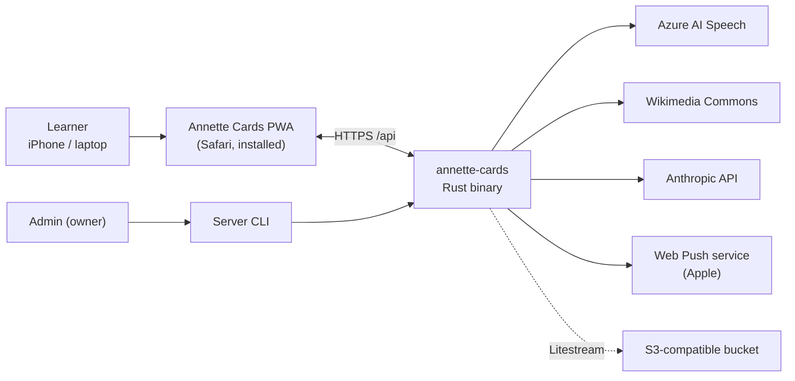
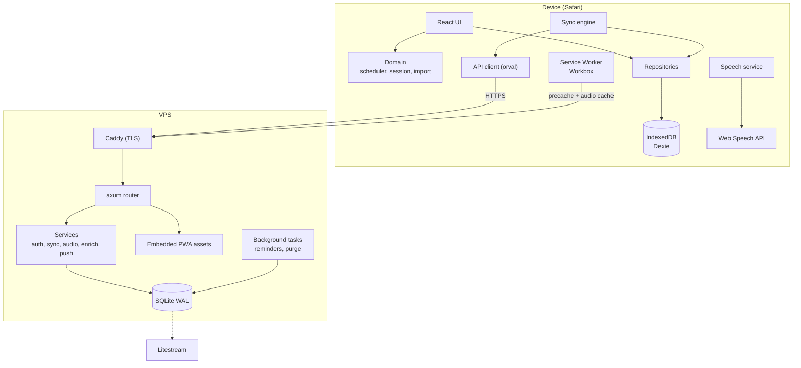
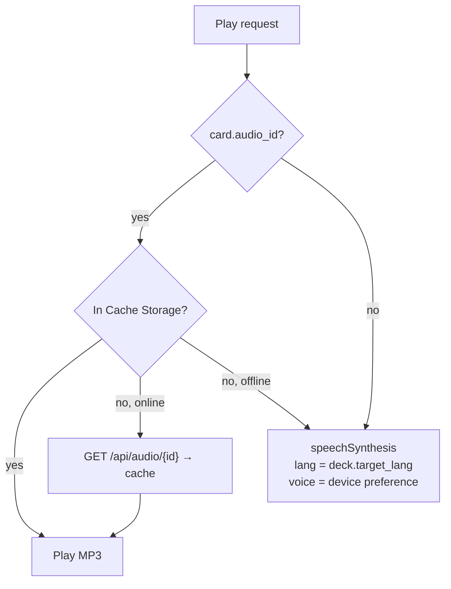
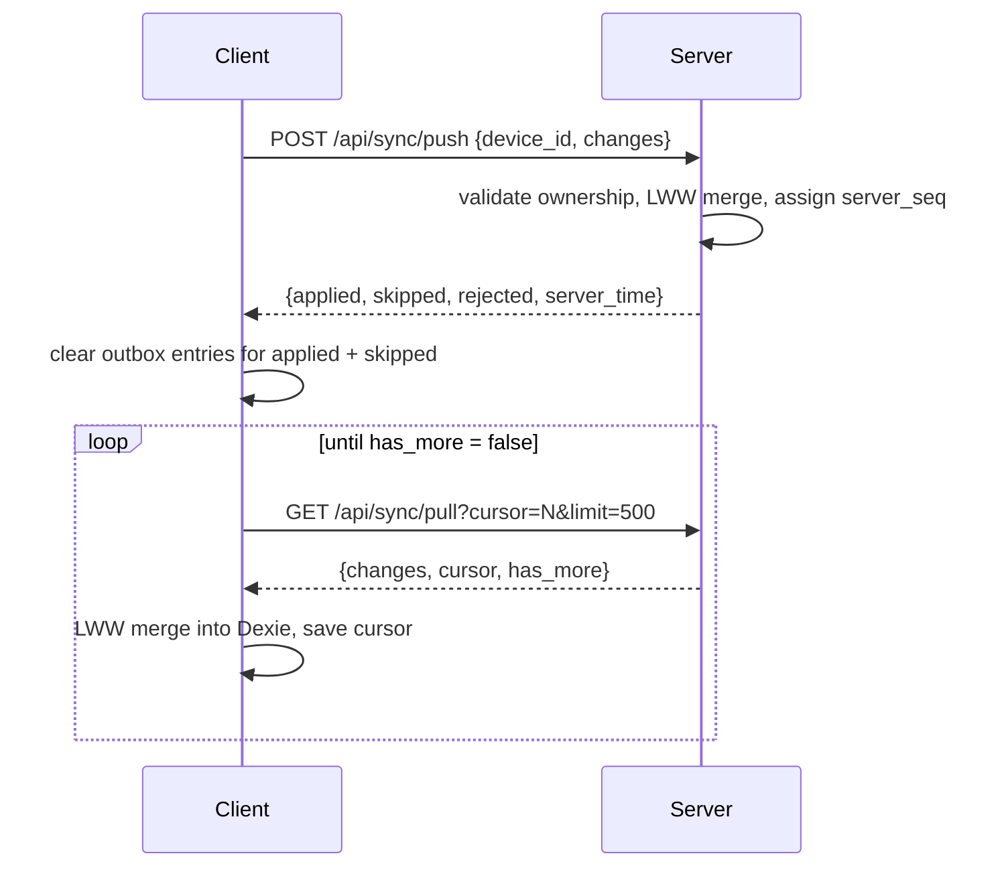
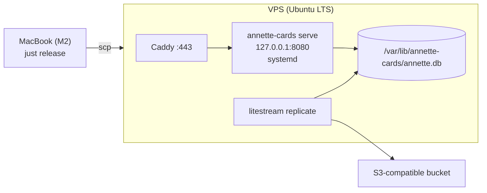

# Architecture

Annette Cards is an offline-first PWA backed by a single Rust binary with an embedded SQLite database. The client
owns the user experience and the scheduling logic; the server provides accounts, multi-device sync, audio
generation and AI enrichment.

## 1. Goals and constraints

| Goal | Consequence |
| --- | --- |
| Works on iPhone without network | Local IndexedDB is the primary store for the UI; FSRS runs on the client |
| Few users (owner + invited family/friends) | Invite-only accounts, SQLite, single process |
| Pronunciation quality matters | Layered audio: system voice → server-generated/recorded MP3 |
| Simple operations | One binary (API + PWA), one DB file, Litestream backups, Caddy for TLS |
| Backend is a Rust learning project | Mainstream crates, thin layers, explicit SQL |

Non-goals: public sign-up, real-time collaboration, shared decks between users (may come later), native iOS app.

## 2. System context



## 3. Containers



## 4. Client architecture

### 4.1 Layers

| Layer | Location | Responsibility | May depend on |
| --- | --- | --- | --- |
| UI | `src/features/*`, `src/components` | Screens, gestures, forms | Hooks, domain, repositories |
| Domain | `src/domain` | Pure logic: FSRS wrapper, session queue, answer checking, CSV parsing, normalization | Nothing app-specific |
| Repositories | `src/db` | Dexie schema, CRUD, transactions, outbox | Domain types |
| Sync engine | `src/features/sync` | Push/pull, conflict resolution, cursor | Repositories, API client |
| Platform services | `src/lib` | Speech, audio cache, storage persistence, i18n, device id | Browser APIs |
| API client | `src/api` (generated) | HTTP calls | — |

### 4.2 Local schema (Dexie)

```ts
db.version(1).stores({
  decks:        'id, updated_at, deleted_at',
  cards:        'id, deck_id, updated_at, deleted_at, *tags',
  card_states:  '[card_id+direction], card_id, due, state, updated_at',
  review_log:   'id, card_id, reviewed_at',
  settings:     'id',                  // single row 'user'
  outbox:       '++seq, [entity+entity_id]',
  meta:         'key',                 // device_id, sync_cursor, account info, last_sync_at
});
```

Device-local preferences (not synced): selected voice per language, speech rate, theme, audio prefetch flag.
They are stored in `meta` because voices differ between devices. `meta` keys (typed in `web/src/db/meta.ts`):
`device_id`, `sync_cursor`, `last_sync_at`, `account`, `voice_pref` (voice per language), `speech_rate`, `theme`,
`audio_prefetch`, `last_quick_add_deck` (deck preselected in Quick add), `extra_new` (`{ study_day, count }`,
extra new cards allowed today), `study_session` (snapshot of the current or last study session for resume within
30 min and the summary; `domain/studySession.ts`). Writes to `meta` never create outbox entries.

### 4.3 Write path

Every mutation runs in a single Dexie `rw` transaction:

1. Validate input (domain).
2. Write the entity with `updated_at = now`, `updated_by = device_id`.
3. Upsert an outbox entry `{entity, entity_id}` (deduplicated by compound index; `card_states` use
   `"<card_id>:<direction>"` as `entity_id`). An existing entry is replaced with a new `seq`, so a push already in
   flight cannot clear a later change.
4. Commit. `useLiveQuery` re-renders subscribed components.
5. Sync engine is notified (debounced 2 s) if the user is signed in and online.

### 4.4 Study engine

**FSRS.** `ts-fsrs` with `enable_short_term = true` (learning/relearning steps), `request_retention` from settings
(default 0.90), `maximum_interval` 36500 days, fuzz enabled. Weights default to ts-fsrs defaults and can be
replaced by optimized weights (Phase 4).

**Directions.** Each card has up to two states: `forward` (see studied word → recall translation) and `reverse`
(see translation → recall studied word). The deck setting decides which directions are active. Every card write
creates a New state for each active direction that has none (`ensureStatesForCards` in `web/src/db/cardStates.ts`);
existing states are never reset. When a direction is switched off, its states are **kept** (hidden from study
queues, not deleted), so switching it back on restores the progress.

**Normalization for duplicates** (`domain/normalize.ts`, decision D10): `normalizeFront(front)` = Unicode NFC,
trim, lowercase, collapse internal whitespace to one space. Two cards in the same deck are duplicates when their
normalized fronts are equal (soft-deleted cards are ignored). Used by the card editor warning, Quick add and CSV
import. Typing-mode answer normalization (P4-T01) builds on it.

**Day boundary.** A "study day" starts at `day_start_hour` (default 04:00 local time). Daily limits and statistics
use study days. `domain/studyDay.ts` works on local calendar fields, so a DST change makes that study day 23 or 25
hours long instead of moving the boundary.

**Daily counters** (`domain/counters.ts`) come from the non-deleted review logs of the current study day: an answer
whose `state_before.state` is New counts as a new card introduced, every other answer as a review done.

**Session queue** (`domain/session.ts`):

0. Eligible: non-deleted card in a non-deleted, non-archived deck, direction active for the deck (optionally one
   deck only; the limits still count answers from all decks).
1. Collect due states: `due <= now` and state ∈ {Review, Relearning, Learning}, oldest `due` first, up to
   `max_reviews_per_day − reviews_done_today`.
2. Collect new states (state = New), ordered by card `created_at` (then id), within two limits: per deck
   `(deck.new_per_day ?? settings.new_per_day) + extra_new − new_introduced_today_in_deck`, and globally
   `settings.new_per_day + extra_new − new_introduced_today`. `extra_new` is the "Learn extra new words"
   allowance (+10 per tap, `meta.extra_new`, reset when the study day changes).
3. Interleave: one new card after every 4 reviews (configurable later).
4. **Bury siblings:** forward and reverse of the same card are not both shown in one study day: a direction is
   skipped when the other one was answered today or is already queued. Learning/Relearning states are never
   buried, so learning steps continue.
5. Learning steps: a card answered with a short next interval (< 20 min) is re-inserted into the current queue at
   its due time (about 10 s per card); if the session ends earlier, it remains due.

**Streak** (`domain/streak.ts`, decision D5; Phase 4 adds the longest streak and the heatmap). The current streak
is the number of consecutive study days with at least one non-undone answer (practice answers count), ending
today, or yesterday when nothing was answered yet today.

**Answer → rating mapping.**

| Mode | Input | FSRS rating |
| --- | --- | --- |
| Swipe (simple) | Swipe left / "Don't know" | Again |
| Swipe (simple) | Swipe right / "Know" | Good |
| Swipe (detailed) | Buttons Again / Hard / Good / Easy; swipe up = Easy | As chosen |
| Multiple choice | Wrong / correct | Again / Good |
| Listening | Wrong / correct | Again / Good |
| Typing | Exact (after normalization) | Good |
| Typing | Near miss (see below) | Hard |
| Typing | Otherwise | Again |

**Typing normalization and tolerance** (`domain/answer.ts`): Unicode NFC, trim, lowercase, collapse spaces, strip
surrounding punctuation, ignore leading articles/particles optionally (`to`, `the`, `a`). Near miss = Damerau–
Levenshtein distance ≤ 1 for answers up to 6 characters, ≤ 2 for longer; or equal after stripping diacritics
(important for Polish: `zolw` vs `żółw`). Differences are highlighted.

**Answer transaction** (`db/study.ts`). Compute `fsrs.next(state, now, rating)`; in one Dexie transaction update
`card_states`, append `review_log` (with previous state snapshot for undo), add outbox entries. `duration_ms` is the
time from the card being shown to the answer, capped at 60 s (a phone put down mid-card does not inflate the time
spent).

**Undo.** Only the last answer in the current session: restore the previous state snapshot (stamped with a new
`updated_at`, so it wins last-write-wins) and soft-delete the log entry (`deleted_at`). An answer that is not the
latest non-deleted log is refused with `undo_not_last`.

**Practice mode** (UC-16, `domain/practice.ts`). The queue holds studied directions with lapses ≥ 3 or stability
< 2 days, plus the cards failed in the last session; most lapses first, at most 50. Every practice answer is
logged with `practice = true`. "Repeat these now" (S-12) practices only the cards failed in that session. A card
that is not due yet keeps its FSRS state (only the log is written); a due card is scheduled normally. Practice
logs, like undone (soft-deleted) logs, are excluded from the daily counters.

### 4.5 Speech and audio



- Voice list is loaded via `speechSynthesis.getVoices()` plus the `voiceschanged` event (wait at most 3 s when the
  first list is empty; refreshed when the app becomes visible again); the preferred voice per language is stored per
  device (`meta.voice_pref`). If none is chosen, the best available voice is used (`lib/speech/voices.ts`): the
  exact locale before other regions of the same language (`en-GB` before `en-US`; `en_GB` is accepted), then
  Premium > Enhanced > default, detected from the voice name or URI ("(Premium)", `com.apple.voice.premium.…`,
  `…enhanced…`), then the system default voice. Rate is device-local (`meta.speech_rate`, 0.5–1.2, default 1.0).
- `lib/speech/speech.ts` exposes `speak(text, { lang, rate, voiceURI })` (synchronous up to
  `speechSynthesis.speak`, so tap handlers keep their gesture) and the `Speaker` interface
  `play(card, lang, 'front' | 'example')`. Phase 1 uses the system-voice speaker; P3-T03 puts a speaker for cached
  server audio (`card.audio_id`) in front of it and falls back to the system one.
- Autoplay in study (`shouldSpeak`): `front` speaks the studied word when a forward card is shown;
  `front_and_back` also speaks it when a reverse card is turned to its answer. The native-language side is never
  spoken. A `not-allowed` error (no gesture yet) makes the card's speaker icon pulse; a tap plays.
- The first utterance must follow a user gesture; the study screen starts with a "Start" tap for this reason.
- `utterance.lang` is always set explicitly (`en-GB`, `en-US`, `pl-PL`).
- Example sentences can be spoken too (tap on the example).
- Optional prefetch after sync: download MP3s for cards of active decks into Cache Storage (`audio-v1`).

### 4.6 Internationalization

- `react-i18next` with `en.json` and `ru.json`; Russian plural forms via i18next plural suffixes.
- Initial UI language: settings value, else `navigator.language` starting with `ru` → Russian, else English.
- Server errors are codes; the client maps them to translation keys (`errors.<code>`).
- Dates and numbers via `Intl` with the UI locale.

### 4.7 PWA

| Aspect | Decision |
| --- | --- |
| Manifest | `display: standalone`, theme colors for light/dark, maskable icons |
| iOS meta | `apple-touch-icon`, `apple-mobile-web-app-capable`, `apple-mobile-web-app-status-bar-style` |
| Precache | App shell (HTML, JS, CSS, fonts, icons) via Workbox |
| Runtime caching | `/api/audio/*` CacheFirst (`audio-v1`, max 5000 entries); other `/api/*` NetworkOnly |
| Updates | `registerType: 'prompt'` → in-app banner "New version available — Reload" |
| Storage | `navigator.storage.persist()` on first run; show a warning if denied and the user is not signed in |
| Install hint | If not `standalone` on iOS, show a one-time "Add to Home Screen" guide |

## 5. Server architecture

### 5.1 Modules

| Module | Responsibility |
| --- | --- |
| `main.rs` | CLI (`clap`): `serve`, `create-user`, `invite`, `openapi`, `purge` |
| `config.rs` | Typed config from env (`figment`) |
| `app.rs` | `AppState` (pool, config, providers), router assembly, middleware |
| `error.rs` | `AppError` → HTTP status + `{ "code": "...", "details": ... }` |
| `db.rs` | Pool creation, pragmas, migrations |
| `auth/` | Login, logout, sessions, invites, `CurrentUser` extractor, password change |
| `sync/` | Push/pull services, LWW merge, ownership validation, `server_seq` allocation |
| `audio/` | `TtsProvider` trait (Azure impl), Commons lookup, `audio_assets` storage and serving |
| `enrich/` | `Enricher` trait (Anthropic impl), prompt, JSON validation, daily quota |
| `push/` | Web Push subscriptions, VAPID, reminder task |
| `fsrs/` | Weight optimization from review logs (Phase 4) |
| `admin/` | Invite management (CLI + admin-only endpoints) |
| `static_files.rs` | Serve embedded PWA with SPA fallback and cache headers |

### 5.2 Request pipeline

`Caddy (TLS)` → `TraceLayer` → `CompressionLayer` → `TimeoutLayer (30 s)` → origin check for unsafe methods →
rate limiter (route-specific) → handler → service → sqlx.

### 5.3 API

All endpoints are under `/api`, JSON, timestamps in ms since epoch. Auth = session cookie `ac_session`.

| Method | Path | Auth | Purpose |
| --- | --- | --- | --- |
| GET | `/api/health` | no | Liveness + DB ping |
| GET | `/api/meta` | no | Server version, enabled features (`tts`, `commons`, `enrich`, `push`) |
| POST | `/api/auth/register` | no | Create account with invite code |
| POST | `/api/auth/login` | no | Email + password → session cookie |
| POST | `/api/auth/logout` | yes | Revoke current session |
| POST | `/api/auth/logout-others` | yes | Revoke all other sessions |
| GET | `/api/auth/me` | yes | Current user profile |
| POST | `/api/auth/password` | yes | Change password |
| POST | `/api/sync/push` | yes | Upload local changes |
| GET | `/api/sync/pull?cursor=&limit=` | yes | Download changes after cursor |
| POST | `/api/cards/{id}/audio` | yes | Generate/fetch audio (`source`: `tts` \| `commons`) |
| DELETE | `/api/cards/{id}/audio` | yes | Remove audio from card |
| GET | `/api/audio/{id}` | yes | MP3 bytes, `Cache-Control: private, max-age=31536000, immutable` |
| POST | `/api/enrich` | yes | Suggest back, example, example_translation, ipa, notes |
| GET | `/api/export` | yes | Full JSON export of the user's data |
| POST | `/api/import/json` | yes | Restore a JSON export into the account (empty account only) |
| POST | `/api/push/subscribe` | yes | Store Web Push subscription |
| DELETE | `/api/push/subscribe` | yes | Remove subscription |
| POST | `/api/fsrs/optimize` | yes | Fit FSRS weights from review log (Phase 4) |
| GET/POST/DELETE | `/api/admin/invites` | admin | List, create, revoke invites |
| GET | `/api/openapi.json` | no | OpenAPI spec |

Error response: `{ "code": "invalid_credentials", "details": null }` with the appropriate HTTP status.

### 5.4 Server data model (SQLite)

All synced tables carry `user_id`, `updated_at`, `updated_by`, `deleted_at`, `server_seq`.

```sql
CREATE TABLE users (
  id            TEXT PRIMARY KEY,
  email         TEXT NOT NULL UNIQUE COLLATE NOCASE,
  display_name  TEXT NOT NULL,
  password_hash TEXT NOT NULL,
  is_admin      INTEGER NOT NULL DEFAULT 0,
  created_at    INTEGER NOT NULL
);

CREATE TABLE invites (
  code        TEXT PRIMARY KEY,           -- random, 12 chars
  created_by  TEXT NOT NULL REFERENCES users(id),
  note        TEXT,
  expires_at  INTEGER NOT NULL,
  used_by     TEXT REFERENCES users(id),
  used_at     INTEGER
);

CREATE TABLE sessions (
  token_hash   TEXT PRIMARY KEY,          -- sha256 of the cookie value
  user_id      TEXT NOT NULL REFERENCES users(id) ON DELETE CASCADE,
  device_label TEXT,
  created_at   INTEGER NOT NULL,
  last_seen_at INTEGER NOT NULL,
  expires_at   INTEGER NOT NULL
);

CREATE TABLE sync_seq (id INTEGER PRIMARY KEY CHECK (id = 1), value INTEGER NOT NULL);

CREATE TABLE decks (
  id           TEXT PRIMARY KEY,
  user_id      TEXT NOT NULL REFERENCES users(id),
  name         TEXT NOT NULL,
  target_lang  TEXT NOT NULL,             -- BCP-47, e.g. en-GB, pl-PL
  native_lang  TEXT NOT NULL,             -- e.g. ru
  directions   TEXT NOT NULL,             -- 'forward' | 'reverse' | 'both'
  new_per_day  INTEGER,                   -- NULL = global setting
  archived_at  INTEGER,
  created_at   INTEGER NOT NULL,
  updated_at   INTEGER NOT NULL,
  updated_by   TEXT NOT NULL,
  deleted_at   INTEGER,
  server_seq   INTEGER NOT NULL
);

CREATE TABLE cards (
  id                  TEXT PRIMARY KEY,
  user_id             TEXT NOT NULL REFERENCES users(id),
  deck_id             TEXT NOT NULL REFERENCES decks(id),
  front               TEXT NOT NULL,
  back                TEXT NOT NULL,
  example             TEXT,
  example_translation TEXT,
  ipa                 TEXT,
  tags                TEXT NOT NULL DEFAULT '[]',   -- JSON array
  notes               TEXT,
  audio_id            TEXT,
  created_at          INTEGER NOT NULL,
  updated_at          INTEGER NOT NULL,
  updated_by          TEXT NOT NULL,
  deleted_at          INTEGER,
  server_seq          INTEGER NOT NULL
);

CREATE TABLE card_states (
  card_id        TEXT NOT NULL REFERENCES cards(id),
  direction      TEXT NOT NULL,           -- 'forward' | 'reverse'
  user_id        TEXT NOT NULL REFERENCES users(id),
  state          INTEGER NOT NULL,        -- 0 New, 1 Learning, 2 Review, 3 Relearning
  due            INTEGER NOT NULL,
  stability      REAL NOT NULL,
  difficulty     REAL NOT NULL,
  elapsed_days   INTEGER NOT NULL,
  scheduled_days INTEGER NOT NULL,
  learning_steps INTEGER NOT NULL,
  reps           INTEGER NOT NULL,
  lapses         INTEGER NOT NULL,
  last_review    INTEGER,
  updated_at     INTEGER NOT NULL,
  updated_by     TEXT NOT NULL,
  deleted_at     INTEGER,
  server_seq     INTEGER NOT NULL,
  PRIMARY KEY (card_id, direction)
);

CREATE TABLE review_log (
  id           TEXT PRIMARY KEY,
  user_id      TEXT NOT NULL REFERENCES users(id),
  card_id      TEXT NOT NULL REFERENCES cards(id),
  direction    TEXT NOT NULL,
  rating       INTEGER NOT NULL,          -- 1 Again, 2 Hard, 3 Good, 4 Easy
  mode         TEXT NOT NULL,             -- 'swipe' | 'choice' | 'listen' | 'typing'
  state_before TEXT NOT NULL,             -- JSON snapshot (for undo / rebuild)
  reviewed_at  INTEGER NOT NULL,
  duration_ms  INTEGER NOT NULL,
  practice     INTEGER NOT NULL DEFAULT 0, -- 1 = answered in practice mode (UC-16); migration in P2-T03
  updated_at   INTEGER NOT NULL,
  updated_by   TEXT NOT NULL,
  deleted_at   INTEGER,
  server_seq   INTEGER NOT NULL
);

CREATE TABLE user_settings (
  user_id     TEXT PRIMARY KEY REFERENCES users(id),
  data        TEXT NOT NULL,              -- JSON, see 5.5
  updated_at  INTEGER NOT NULL,
  updated_by  TEXT NOT NULL,
  server_seq  INTEGER NOT NULL
);

CREATE TABLE audio_assets (
  id          TEXT PRIMARY KEY,
  user_id     TEXT NOT NULL REFERENCES users(id),
  card_id     TEXT NOT NULL REFERENCES cards(id),
  source      TEXT NOT NULL,              -- 'azure' | 'commons'
  mime        TEXT NOT NULL,              -- 'audio/mpeg'
  voice       TEXT,
  attribution TEXT,                       -- author + license for Commons
  bytes       BLOB NOT NULL,
  created_at  INTEGER NOT NULL
);

CREATE TABLE push_subscriptions (
  id         TEXT PRIMARY KEY,
  user_id    TEXT NOT NULL REFERENCES users(id),
  endpoint   TEXT NOT NULL UNIQUE,
  p256dh     TEXT NOT NULL,
  auth       TEXT NOT NULL,
  created_at INTEGER NOT NULL
);

CREATE TABLE enrich_usage (
  user_id TEXT NOT NULL REFERENCES users(id),
  day     TEXT NOT NULL,                  -- YYYY-MM-DD (UTC)
  count   INTEGER NOT NULL,
  PRIMARY KEY (user_id, day)
);

CREATE INDEX idx_decks_user_seq        ON decks(user_id, server_seq);
CREATE INDEX idx_cards_user_seq        ON cards(user_id, server_seq);
CREATE INDEX idx_states_user_seq       ON card_states(user_id, server_seq);
CREATE INDEX idx_states_user_due       ON card_states(user_id, due);
CREATE INDEX idx_log_user_seq          ON review_log(user_id, server_seq);
CREATE INDEX idx_log_user_reviewed     ON review_log(user_id, reviewed_at);
```

### 5.5 Settings document

```json
{
  "ui_language": "ru",
  "day_start_hour": 4,
  "new_per_day": 15,
  "max_reviews_per_day": 200,
  "answer_mode": "simple",
  "desired_retention": 0.9,
  "fsrs_weights": null,
  "autoplay": "front",
  "reminder": { "enabled": false, "time": "20:00", "tz": "Europe/Riga" },
  "default_directions": "both",
  "show_ipa_on_front": true
}
```

- `answer_mode`: `simple` | `detailed`; `autoplay`: `off` | `front` | `front_and_back` (UI: Off / Front / Front and answer).
- `default_directions` (`forward` | `reverse` | `both`): directions preselected for a new deck.
- `show_ipa_on_front`: show the IPA with the studied word on the front of a study card.
- Missing fields fall back to these defaults (`web/src/domain/settings.ts`), so older documents stay valid.

## 6. Synchronization protocol

### 6.1 Principles

- Client is authoritative for its own edits; server is the rendezvous point.
- **Cursor** = server-assigned monotonic `server_seq` (global counter in `sync_seq`), never client clocks.
- **Conflict resolution** for mutable rows: last-write-wins by `(updated_at, updated_by)` — the larger
  `updated_at` wins; ties broken by lexicographically larger `updated_by`.
- `review_log` is append-only and idempotent by `id`; only `deleted_at` may change (undo).
- Soft deletes propagate like any other change. A deleted deck implies its cards are hidden on both sides; the
  client also marks the cards and their states deleted, in the same transaction and with the same `deleted_at`
  (which lets "Undo" restore exactly those rows).
- Clock skew risk is accepted for a personal app; the client warns if `|server_time − device_time| > 5 min`.

### 6.2 Sequence



### 6.3 Payloads

```json
// POST /api/sync/push
{
  "device_id": "0192f6c1-...",
  "changes": {
    "decks":       [{ "id": "...", "name": "English B2", "target_lang": "en-GB", "native_lang": "ru",
                      "directions": "both", "new_per_day": null, "archived_at": null,
                      "created_at": 1758441600000, "updated_at": 1758441600000,
                      "updated_by": "0192f6c1-...", "deleted_at": null }],
    "cards":       [],
    "card_states": [],
    "review_log":  [],
    "settings":    null
  }
}

// response
{
  "applied":  { "decks": ["..."], "cards": [], "card_states": [], "review_log": [], "settings": false },
  "skipped":  { "cards": ["..."] },            // server version was newer (LWW lost); client will receive it on pull
  "rejected": [{ "entity": "cards", "id": "...", "code": "deck_not_owned" }],
  "server_time": 1758441601234
}

// GET /api/sync/pull?cursor=1200&limit=500
{
  "changes": { "decks": [], "cards": [], "card_states": [], "review_log": [], "settings": null },
  "cursor": 1340,
  "has_more": false
}
```

`review_log` rows carry `practice` (boolean in JSON, `0/1` in SQLite; decision D2).

Push is processed in one SQLite transaction per request; the client sends batches of at most 500 rows. Entities
are applied in dependency order: decks → cards → card_states → review_log → settings.

### 6.4 Triggers and first sign-in

- Sync runs on app start, on `visibilitychange` to visible, on `online`, 2 s after local changes (debounced),
  and via a manual button.
- **First sign-in on a device with local data** (created in local-only mode):
  - Server account empty → push everything.
  - Both non-empty → user chooses: *Merge* (push local, then pull), *Use server data* (clear local, pull), or
    *Cancel*.
- **Sign-out** warns when the outbox is not empty, then clears IndexedDB and Cache Storage.

### 6.5 Backup format

A full backup (UC-24, UC-25) is one JSON document. The client writes it locally (Phase 1); `GET /api/export` and
`POST /api/import/json` (P2-T04) use the same format.

```json
{
  "format": "annette-cards-backup",
  "version": 1,
  "exported_at": 1758441600000,
  "app_version": "0.1.0",
  "decks": [], "cards": [], "card_states": [], "review_log": [],
  "settings": { "ui_language": "ru", "...": "§5.5" }
}
```

- Rows use the sync payload shape (§6.3) without `user_id`/`server_seq`. Only non-deleted rows are exported, and
  only states and logs whose card is exported.
- `version` changes only for incompatible changes. A reader rejects a newer version with `unsupported_version`
  and reports `app_version` as the app version needed. A file without the `format` marker, or with a card, state
  or log that points outside the file, is `invalid_format`.
- **Replace local data**: one transaction soft-deletes every local deck, card, state and log entry, then writes
  the backup rows and settings. **Add as new decks**: decks, cards and logs get new UUIDv7 ids (states follow
  their card), written in transactions of about 500 rows; settings stay unchanged.
- Restored rows are stamped with this device (`updated_at = now`) and outboxed, so they sync like new edits.
  Cards without a state for an active direction get a New state.
- Deck CSV export uses the import format (README "Import format"), tags joined by spaces, with a UTF-8 BOM.

## 7. Audio pipeline (server)

1. `POST /api/cards/{id}/audio {source: "tts", voice?}`: build SSML from `card.front`; if `card.ipa` is set, wrap
   the text in `<phoneme alphabet="ipa" ph="…">`; call Azure; store MP3 in `audio_assets`; set `card.audio_id`,
   bump `updated_at` and `server_seq` so other devices pick it up.
2. `source: "commons"`: query Wiktionary/Commons for pronunciation files matching the word and language; download,
   ensure a Safari-playable format (see open questions), store with attribution; same card update.
3. Responses: `{ "audio_id": "...", "attribution": "..." }` or error codes `tts_disabled`, `not_found`,
   `provider_error`.
4. Rate limit: 60 requests/hour per user.

## 8. Enrichment (server)

- `POST /api/enrich {front, target_lang, native_lang, context?}` → `{back, example, example_translation, ipa, notes}`.
- Prompt instructs the model to return strict JSON; the server validates with serde and retries once on invalid
  output. Suggestions are never saved automatically — the user confirms in the card editor.
- Quota: `ANNETTE_ENRICH_DAILY_LIMIT` per user (default 200), tracked in `enrich_usage`.

## 9. Security

| Area | Measure |
| --- | --- |
| Transport | HTTPS only (Caddy), HSTS |
| Passwords | Argon2id, min length 10, login rate limit 10/min per IP |
| Sessions | 32 random bytes, stored as SHA-256 hash; cookie `HttpOnly; Secure; SameSite=Strict; Path=/`; 90-day sliding expiry |
| CSRF | SameSite=Strict + `Origin` header check on non-GET requests |
| Authorization | `user_id` filter in every query; parent ownership checks on push |
| Registration | Invite-only (single-use codes with expiry) |
| Input limits | Body size 2 MB (push batches), field length limits (front/back ≤ 500 chars, notes ≤ 2000; client also: example and its translation ≤ 2000, IPA ≤ 200, each tag ≤ 50 — `domain/cardValidation.ts`) |
| Secrets | Env file readable only by the service user |
| Headers | CSP (`default-src 'self'`), `X-Content-Type-Options`, `Referrer-Policy` |

## 10. Configuration

Sources, later ones win: built-in defaults → optional `annette.toml` in the working directory → environment
variables. `server/.env.example` lists every variable; copy it to `server/.env` for local development (`just`
recipes load it).

| Variable | Default | Description |
| --- | --- | --- |
| `ANNETTE_BIND` | `127.0.0.1:8080` | Listen address |
| `ANNETTE_DATABASE_URL` | `sqlite://data/annette.db` | SQLite path |
| `ANNETTE_PUBLIC_URL` | — | Public origin, used for the Origin check |
| `ANNETTE_SESSION_TTL_DAYS` | `90` | Sliding session lifetime |
| `ANNETTE_AZURE_TTS_KEY` / `_REGION` | — | Enables TTS |
| `ANNETTE_COMMONS_ENABLED` | `true` | Enables Wikimedia lookup |
| `ANTHROPIC_API_KEY` | — | Enables enrichment |
| `ANNETTE_LLM_MODEL` | configurable | Model name for enrichment |
| `ANNETTE_ENRICH_DAILY_LIMIT` | `200` | Per-user daily quota |
| `ANNETTE_VAPID_PUBLIC_KEY` / `_PRIVATE_KEY` | — | Enables Web Push |
| `RUST_LOG` | `info` | Log filter |

## 11. Background tasks

| Task | Interval | Action |
| --- | --- | --- |
| Session cleanup | hourly | Delete expired sessions |
| Reminders | every minute | For users whose reminder time (in their tz) is now and who have due cards, send Web Push |
| Purge | daily | Physically delete rows soft-deleted > 90 days ago and orphaned audio |

## 12. Deployment



- Binary at `/opt/annette-cards/releases/<version>/annette-cards`, symlink `current`; `just deploy` uploads,
  switches the symlink atomically and restarts the service. Rollback = switch the symlink back.
- systemd unit runs as user `annette` with `ProtectSystem=strict`, `ReadWritePaths=/var/lib/annette-cards`,
  `NoNewPrivileges=true`, `EnvironmentFile=/etc/annette-cards/env`.
- Caddy: `cards.example.com { reverse_proxy 127.0.0.1:8080; encode zstd gzip }`.
- Litestream replicates the database continuously; restore procedure documented in `deploy/README.md`.
- Migrations run on startup inside a transaction; a failed migration aborts startup (old binary keeps running
  until restart).

## 13. Observability

- Structured JSON logs (`tracing`) to journald; request id, user id (hashed), latency, status.
- `GET /api/health` for uptime checks (DB ping).
- Client: sync errors and last successful sync time visible in Settings → Sync.

## 14. Key decisions

| # | Decision | Alternatives considered |
| --- | --- | --- |
| ADR-1 | Offline-first with IndexedDB as the UI's store | Online-first SPA — fails in metro/plane use |
| ADR-2 | FSRS on the client (`ts-fsrs`) | Server-side scheduling — breaks offline study |
| ADR-3 | LWW row-level sync with server cursor | CRDTs — unnecessary complexity for single-user data |
| ADR-4 | SQLite + Litestream | PostgreSQL — extra ops for no benefit at this scale |
| ADR-5 | Opaque sessions in cookies | JWT — key management and revocation complexity |
| ADR-6 | Audio as BLOBs in SQLite | Filesystem/S3 — separate backup path |
| ADR-7 | PWA instead of native app | SwiftUI — better iOS integration, but new language and no web/desktop use |
| ADR-8 | Code-first OpenAPI (utoipa) | Spec-first — no mature Rust server generator |

## 15. Open questions

- Are Wikimedia pronunciation files (usually OGG) playable in iOS Safari for all target versions? If not, add
  server-side transcoding to MP3/AAC (ffmpeg as a runtime dependency, or a pure-Rust decoder + encoder).
- Should decks be shareable between users (e.g. the owner prepares a deck for a family member)? Current model:
  copy via JSON export/import.
- Is 1 GB SQLite size (mostly audio) a realistic limit for the expected vocabulary volume, or should audio move
  to object storage earlier?
