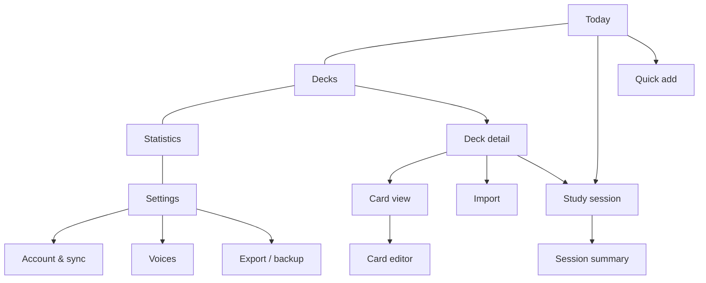

# UI / UX

This document describes the user interface of Annette Cards: design principles, navigation, every screen with
its elements and states, gestures and interaction details. Use case references (UC-xx) point to
[`use_cases.md`](use_cases.md).

## 1. Design principles

1. **Phone first, one hand.** Primary target is an iPhone in portrait. Primary actions sit in the lower half of
   the screen (thumb zone). Desktop is supported with a centered column (max width 480 px for study, 720 px for
   lists).
2. **Study in seconds.** From opening the app to the first card: one tap ("Start" on Today).
3. **Calm and focused.** During study there is no navigation chrome, only the card, progress and exit.
4. **Offline is normal.** Nothing is disabled offline except server features (audio generation, AI, sync); those
   show a small "Offline" hint instead of errors.
5. **Everything is reversible.** Undo last answer, soft delete with an undo snackbar, import preview before
   commit.
6. **Bilingual.** All text via i18n (RU/EN); layouts tolerate longer Russian strings.

## 2. Visual language

| Element | Guideline |
| --- | --- |
| Theme | Light and dark, follows system by default; manual override in Settings |
| Color | Neutral base; one accent color; semantic green (know/Good), red (don't know/Again), amber (Hard), blue (Easy) |
| Typography | System font stack (SF Pro on iOS). Card word 32–40 px, translation 22–28 px, body 16 px (never below 16 px in inputs to avoid iOS zoom) |
| Spacing | 4 px grid; touch targets ≥ 44×44 px |
| Shape | Cards with 20–24 px radius and soft shadow; buttons 12 px radius |
| Icons | lucide-react |
| Motion | Spring animations for cards; respect `prefers-reduced-motion` (fade instead of fly/tilt) |
| Safe areas | Padding with `env(safe-area-inset-*)` for notch and home indicator |

## 3. Navigation

- **Bottom tab bar** with four tabs: Today, Decks, Statistics, Settings. Hidden during study, import wizard and
  editors (full-screen flows with a back/close button).
- **Floating "+" button** on Today and Decks opens Quick add (UC-06).
- Back navigation: top-left chevron; iOS edge-swipe back works because routes are real history entries.
- Deep links: `/study?deck=<id>&mode=swipe`, `/decks/<id>`, `/cards/<id>`.

Routes (`web/src/app/router.tsx`; "full screen" = no tab bar):

| Path | Screen | Full screen |
| --- | --- | --- |
| `/` | S-04 Today | |
| `/decks`, `/decks/$deckId` | S-05 Decks list, S-06 Deck detail | |
| `/cards/$cardId` | S-07 Card view | |
| `/cards/new`, `/cards/$cardId/edit` | S-08 Card editor | yes |
| `/import` | S-10 Import wizard | yes |
| `/study?deck=&mode=&practice=1&repeat=` | S-11 Study session (`mode`: `swipe`, `choice`, `listening`, `typing`; `repeat` = session id for "Repeat these now") | yes |
| `/study/summary?session=` | S-12 Session summary | yes |
| `/stats` | S-13 Statistics | |
| `/settings`, `/settings/account`, `/settings/voices` | S-14 Settings, S-15 Account & sync, S-16 Voices | |
| `/welcome` | S-01 Onboarding | yes |
| `/signin?invite=`, `/register?invite=` | S-02 Sign in / Register | yes |
| `/first-sync` | S-03 First sync choice | yes |

Quick add (S-09) is a sheet over the current screen, not a route.

## 4. Global components

| Component | Behavior |
| --- | --- |
| Sync indicator | Small icon in the top bar of Today and Settings, hidden when signed out; tap opens S-15: synced (cloud with ✓), syncing (spinner), pending changes (cloud with a count badge), offline (cloud-off), error (cloud with a red dot: the last run failed or the session expired). VoiceOver reads the state, e.g. "3 changes waiting to sync" |
| Snackbar | Bottom, above tab bar; used for undo ("Card deleted · Undo"), success and non-blocking errors; 4 s |
| Update banner | "A new version is available · Reload" when the service worker has an update |
| Install hint | One-time sheet on iOS Safari when not installed: 3 illustrated steps "Share → Add to Home Screen" |
| Offline hint | Inline text next to server-only actions: "Available online" |
| Empty states | Illustration-free: short text + one primary action |
| Confirm sheet | iOS-style bottom sheet for destructive actions |

## 5. Screens

Each screen lists purpose, layout, elements, states and interactions.

### S-01 Welcome / Onboarding

**Purpose:** first-run setup (UC-01). Shown once per device when no local data and no account.

**First-run rule:** opening `/` redirects to `/welcome` while this device has no deck (soft-deleted decks count, so
someone who deleted every deck is not new) and `meta.onboarding_done` is not set. Deep links to other screens are
never redirected; `/welcome` redirects to `/` once onboarding is no longer needed. Onboarding writes nothing until
the first-deck step except the UI language switch; then the goal (`settings.new_per_day`), the deck (named after the
language, directions from `settings.default_directions`) and `onboarding_done` are stored in one transaction.

**Steps (horizontal pager with dots, "Next"/"Back"):**

1. **Welcome** — app name, one-line value proposition, UI language switch (RU/EN), buttons "Get started" and
   "I have an account" (→ S-02; hidden once this device is signed in).
2. **Languages** — "I'm learning" (searchable list; EN and PL pinned at top, with locale variant chips en-GB /
   en-US) and "My language" (default Russian).
3. **Daily goal** — new words per day: 5 / 10 / 15 / 25 / custom (default 15). Short explanation of spaced
   repetition (two sentences).
4. **First deck** — "Import a file" (→ S-10), "Add words manually" (→ S-08), "Start with an empty deck".
5. **Install & persist** (iOS Safari not in standalone) — install hint; call `storage.persist()` after the user
   taps "Continue" (this also counts as the one-time install hint). Elsewhere `storage.persist()` is called when a
   first-deck option is chosen; the app-wide first-run request waits while `/welcome` is open.

**States:** language list loading voices (spinner next to "Voice available" markers); no voice for the chosen
language → warning with the iOS voice guide (expandable, so the onboarding state is kept); onboarding continues.
Next is disabled until a studied language is chosen; a custom goal accepts whole numbers 1–200.

### S-02 Sign in / Register

**Purpose:** account access (UC-02, UC-03).

**Layout:** segmented control "Sign in" | "Register"; `/signin` and `/register` are the two sides (switching keeps
`?invite=`).

- Sign in: email, password (show/hide), "Sign in" button, error text under the form.
- Register: invite code (prefilled from `?invite=` link), display name, email, password with a length hint ("At
  least 10 characters" until it is long enough); "Create account" is enabled once every field is filled.
- After success → S-03 (first sync; the choice appears only when both this device and the account have data).

**States:** offline → form disabled with "Connect to the internet to sign in"; errors mapped from codes
(`invalid_credentials`, `invite_invalid`, `invite_expired`, `email_taken`, `rate_limited`, `network`, …).

### S-03 First sync choice

**Purpose:** resolve local vs server data on first sign-in (UC-04).

Opened after every sign-in or registration (architecture.md §6.4). "Checking your account…", then the choice only
if both this device and the account have data: counts ("On this device: 2 decks, 340 cards · In your account: 3
decks, 1 210 cards") and three options: **Merge** (recommended), **Use account data** (local data will be removed —
confirm sheet), **Cancel** (signs out again, back to the previous screen). Otherwise, and after a choice, a
determinate bar "Syncing your data…" (below 100 % until done), then Today (or onboarding when the device is still
empty). Errors: the check failed → message with "Try again" / "Cancel"; the first sync failed → message "syncing
continues in the background" and "Continue".

### S-04 Today (home)

**Purpose:** daily entry point (UC-08).

**Layout (top → bottom):**

- Top bar: greeting with the display name when signed in ("Hi, Anna!", else "Hi there!"), sync indicator.
  Pulling the page down while signed in syncs now ("Pull to sync" → "Release to sync" → "Syncing…").
- **Hero card:** "To review: 42 · New: 15", estimated time ("≈ 9 min"), primary button **Start** (full width,
  thumb zone). If nothing is due: text "Nothing due. Next reviews in 3 h" and secondary actions "Learn extra new
  words" (shown when new cards are waiting beyond today's limit; +10 for today, then the session starts) and
  "Practice difficult words" (shown when the practice queue has cards).
- Mode selector under Start (chips): Swipe (default), Choice, Listening, Typing (decision D4: added in Phase 4).
  The choice is kept on this device (`meta.study_mode`) and applies to Start, "Learn extra new words", "Practice
  difficult words" and the "Decks due" rows (`/study?mode=…`). Choice, and Listening while it is answered by
  choosing, are disabled with the hint "Choice and listening need at least 4 different words in one language" when
  no studied language of the active decks has 4 different words; a disabled stored mode falls back to Swipe.
- **Streak** row: flame icon, "12 days", 7-day dots. A study day with at least one answer (practice included,
  undone answers not) continues the streak; today not studied yet does not break it, a missed yesterday does.
- **Decks due** list (compact): deck name, language flag code (EN/PL), due count; tap → start session for that
  deck only.
- Floating "+" (Quick add).

**States:** first day (no reviews yet) shows only new-card count; no cards at all → "Add words to start studying"
with a link to Decks; loading skeleton for < 200 ms is avoided (Dexie is fast) — render directly.

### S-05 Decks list

**Purpose:** manage decks (UC-05).

**Layout:** title "Decks", search field (appears on pull-down), list of deck rows:

- Name, language pair ("EN-GB → RU"), card count, progress bar (new / learning / mature), due badge.
- Swipe row left → Archive / Delete; long-press → context menu (Rename, Settings, Export, Delete).
- Every swipe/long-press action is also in the row's "⋯" menu. Archive shows a 4 s "Deck archived · Undo"
  snackbar; Export is enabled in P1-T06.
- Section "Archived" collapsed at the bottom.
- "New deck" button in the header → create deck sheet: name (required, ≤ 100 chars), target language (EN-GB, EN-US,
  PL pinned as chips, others in a picker), native language (default Russian), directions (Forward / Reverse / Both,
  default from settings), optional new-per-day override. The same sheet edits deck settings. The floating "+" on
  this screen opens Quick add (§3), not the create deck sheet.

**Empty state:** "No decks yet" + buttons "Create deck", "Import file".

### S-06 Deck detail

**Purpose:** browse and filter cards, launch deck-specific study (UC-05, UC-16).

**Layout:**

- Header: deck name, language pair, overflow menu (Deck settings, Import into deck, Export deck, Archive,
  Delete).
- Stats strip: New · Learning · Review · Difficult (lapses ≥ 3); tapping a chip filters the list.
- Buttons: **Study deck**, **Practice difficult**.
- Search (front, back, example, tags) and sort (Added ↓, Due ↑, Alphabetical, Difficulty ↓).
- Tag filter chips (horizontal scroll).
- Card list rows: front (bold), back (secondary), small speaker button, status dot (color by state), due date.
  Virtualized list for 5 000+ cards.
- Multi-select mode (long-press, or "Select" in the overflow menu): move to deck, add/remove tag, reset progress,
  delete (confirm + Undo snackbar). Swipe a row left → Delete (Undo snackbar).

Filter definitions (a card with two directions can match several): **New** — any direction is New;
**Learning** — any direction is Learning or Relearning; **Review** — any direction is in Review; **Difficult** —
lapses ≥ 3 in any direction. Only directions active in the deck count. Search matches front, back, example and
tags, ignoring case, extra spaces and Unicode form. Sort "Due ↑" puts never-studied cards last. The status dot
shows the most urgent direction: learning (amber), review (green), new (blue). Reset progress keeps the answer
history.

**Empty state:** "This deck is empty" + "Add word", "Import".

### S-07 Card view

**Purpose:** see everything about one card (UC-07, UC-12).

**Layout:** large front word + speaker button; IPA under it; translation; example (tap → speak) and its
translation; tags; notes. Section **Pronunciation**: current source (System voice / Generated / Recording with
attribution; "Server audio" while a clip that is not cached yet cannot be downloaded), buttons "Generate audio",
"Find recording", "Remove audio" (signed in only; each shown only when the server offers the feature — `/api/meta`,
remembered offline; disabled offline with the "Available online" hint). A new clip plays once; errors are shown
under the buttons ("No recording found for this word.", quota, service errors).
Section **Progress** per direction: state, next due, stability, difficulty, reps, lapses, and a mini history of
the last 10 answers (colored dots). Actions: Edit, Reset progress, Delete.

### S-08 Card editor (add / edit)

**Purpose:** create or modify a card (UC-06, UC-07, UC-09).

**Fields:** Deck (picker), Front*, Back*, Example, Example translation, IPA (with helper keyboard row for common
IPA symbols), Tags (chips with autocomplete from existing tags), Notes.

- Button **"Fill with AI"** under Front (shown when signed in and the server offers enrichment; enabled when Front
  is not empty and online, otherwise disabled with "Available online"; a spinner while waiting, the form stays
  editable): each suggested field shows its suggestion under it as a ghost value (muted, dashed border) with a ✓
  to accept it; **"Accept all"** next to the button fills the empty fields at once. Accepting into a filled field
  (one or via Accept all) asks first ("Replace the filled field?" / "Replace N filled fields?"); Cancel keeps the
  value and the ghost. Editing a field dismisses its ghost; a suggestion equal to the value is not shown. Errors
  inline under Front: "Daily AI limit reached, try tomorrow." for the quota, otherwise "Could not get suggestions,
  fill in manually." (timeout, provider error, network).
- **Duplicate warning** under Front when the same normalized front exists in the deck: "Already in deck:
  *to take off — взлетать*" with link.
- Speaker button next to Front to preview pronunciation with the deck's voice.
- Save (top-right) / Cancel; "Save and add another" in add mode keeps the deck and tags.

**Validation:** Front and Back required, length limits, trimming whitespace.

### S-09 Quick add

**Purpose:** capture a word in seconds (UC-06).

Bottom sheet over the current screen: deck selector (remembers last), single field "Word or phrase", Enter →
if online, signed in and AI enabled, "Getting suggestions…", then a suggestion card (translation, IPA, example and
its translation, notes) with **Edit**, and the main button becomes **Save**: one tap (or Enter) saves the word with
all suggested fields. **Edit** opens the card editor (S-08) with the word filled in and the suggestions as ghosts.
Changing the word drops the suggestions. Offline, AI disabled, signed out, or the request failed → second field
"Translation" appears (a failed request adds a one-line hint above it: the quota text or "Could not get
suggestions, fill in manually."). After save: snackbar "Added · Edit", field cleared, keyboard stays open.

In Phase 1 the two-field flow (word → Enter → translation → Enter) is used online and offline; AI suggestions
arrived in Phase 3. A duplicate (same normalized front in the deck) shows an inline warning with "Add anyway" and
"Open existing"; the card is not saved until one is chosen.

### S-10 Import wizard

**Purpose:** import CSV/TSV (UC-10).

1. **Source:** pick file (Files app), or paste text; target deck (existing or new).
2. **Preview & mapping:** detected delimiter and encoding shown; table with first 10 rows; each column header has
   a dropdown mapped to fields (front, back, example, example_translation, ipa, tags, notes, ignore); auto-mapping
   by header names (`front`, `word`, `слово`, `back`, `translation`, `перевод`, ...). Toggle "First row is a
   header".
3. **Validation:** counts: ready / duplicates (skip, update existing, import anyway) / errors (missing front or
   back, too long, with row numbers). Download error report. Import is blocked with an explanation when nothing
   is importable.
   - Duplicates are found by `normalizeFront` against the deck and against earlier rows of the file.
   - **Skip** (default) ignores them; **Update existing** overwrites the existing card's fields with the row's
     non-blank cells and keeps its progress; **Import anyway** adds new cards.
   - Error report: `import-errors.csv` with columns `row,reason`, one line per error; `row` is 1-based and does
     not count the header row.
4. **Result:** "Imported 312 cards into *English B2*" (plus updated/skipped counts), buttons "Study now", "Open
   deck".

Large files (10 000 rows) are parsed in a Web Worker with a progress bar.

### S-11 Study session

**Purpose:** learning and reviewing (UC-11…UC-15). Full-screen, no tab bar.

**Common layout:**

- Top: close (×) with confirm if answers were given ("Answers are saved. Leave the session?"); progress bar
  (done / total: answers given out of answers given plus cards left, so a card that returns for a learning step
  adds to the total); counters "New 3 · Learning 2 · Review 17" for the cards left; undo button (↶) enabled after
  the first answer, putting the card back on top.
- Center: the exercise.
- Bottom: answer controls in the thumb zone.

**Start gate:** the first screen shows the deck (or "All decks"), practice mode and the number of cards, and a
large **Start** button (**Continue** when a session is resumed); this tap unlocks speech synthesis on iOS. An
unknown deck id or an empty queue shows an empty state instead.

#### Mode A — Swipe cards (default)

- Card shows the prompt: for *forward*, the studied word (+ IPA if set in settings), audio autoplay per setting;
  for *reverse*, the translation.
- **Tap** flips the card (3D flip, 250 ms) to reveal the answer, example and notes; in reverse direction audio
  plays on reveal.
- **Swipe right** = Know (Good), **swipe left** = Don't know (Again). In detailed mode **swipe up** = Easy and a
  "Hard" button is shown.
- Drag feedback: card follows the finger with rotation up to ±12°; a colored overlay and label ("Know" / "Again" /
  "Easy") fade in proportionally; commit threshold = 35 % of the card area width or velocity > 600 px/s in the
  drag direction; swipe up (detailed mode, mostly vertical drag) commits at 30 % of the card area height or an
  upward velocity > 600 px/s; otherwise spring back. The buttons fly the card out the same way (Again left, Hard
  and Good right, Easy up).
- Buttons below the card (accessible alternative): ✗ Again · (Hard) · ✓ Good · (Easy); in simple mode only ✗ and ✓.
- Swiping without flipping is allowed (fast "I know it" flow).
- Next card slides in from the stack (the next two cards are visible as a stack behind).

#### Mode B — Multiple choice

Prompt on top (the studied word for *forward*, the translation for *reverse*), four options as large buttons
(≥ 44 px, shuffled): the answer and three distractors. Correct → green, short delay (600 ms), next (Good). Wrong →
chosen red, correct green, the card turns to its answer side (translation, example, notes); "Continue" (Again).
Distractors (`domain/distractors.ts`): other cards of the same deck first, then cards sharing the most tags, then
the most similar length, ties at random; the target and values equal to the answer or to another option (after
`normalizeFront`) are skipped. When the deck has too few, cards of the other active decks with the same studied
language fill in. A card whose language offers fewer options still gets the ones that exist; with none at all it
is asked by typing (Mode D).

#### Mode C — Listening

The studied word is played when the card appears (server clip or system voice; the session's Start tap unlocked
audio on iOS), with a large replay button and "Play slower" (speech rate 0.7, or MP3 `playbackRate` 0.7).
Listening always asks for the **studied word**, whatever the card's direction (the answer is logged for that
direction with `mode = 'listen'`). Answer by choosing among four written words (default) or by typing (setting
"Listening mode answer"); typing is checked as in Mode D (near miss → Hard). After the answer the card shows the
word, its translation and example. Without other words to offer, the answer is typed.

#### Mode D — Typing

Prompt card, input field with auto-focus (font ≥ 16 px, no autocapitalize/autocorrect/spellcheck), `lang` of the
answer language as the keyboard hint, "Check" button and Enter. Expected answer per direction: *reverse* shows the
translation and expects the studied word; *forward* shows the studied word and accepts any `;`-separated meaning
of the translation. The input stays mounted between cards, so the iPhone keyboard stays open. Result
(announced via `aria-live`):

- Correct → green, next card after 600 ms (Enter does not need to be pressed again).
- Near miss → amber "Almost", diff highlighting (missing letters underlined, extra letters struck through,
  missing diacritics shown as the correct letter `ż`), rating Hard, "Continue" (or Enter).
- Wrong → red, correct answer shown, the studied word spoken (the correct answer in reverse, the prompt in
  forward), "Continue".
- "I don't know" link = Again, shown like a wrong answer.

**Session end:** automatically when the queue is empty → S-12.

**Interruptions:** leaving the app mid-session keeps all given answers (each is saved immediately); returning
within 30 min resumes the same queue. After every answer the session snapshot (remaining queue, answer log ids,
last answer for undo, `started_at`, `last_active_at`) is saved to the device-local `meta.study_session`; opening
`/study` with the same deck and practice flag within 30 min of `last_active_at` resumes it at the same card.
Closing the session with × ends it (the snapshot is removed); a finished session stays in `meta` for the summary.

### S-12 Session summary

Cards reviewed, accuracy %, time spent, new words learned, streak update, list of "Difficult in this session"
(Again at least once) with button **Repeat these now** (extra practice, does not affect FSRS for cards already
answered today — practice mode) and **Done**.

The route is `/study/summary?session=<id>`; the numbers come from the finished session kept in
`meta.study_session` (its answer log ids). **Repeat these now** opens `/study?practice=1&repeat=<session id>`,
which reads the cards answered Again from that session and practices only them. Once another session replaces the
snapshot, the summary shows "This session summary is no longer available".

### S-13 Statistics

**Purpose:** progress overview (UC-19). Computed on the device, works offline; the route loads lazily (the chart
library is precached by the service worker).

- Period switcher: 7 days / 30 days / 1 year (study days ending today, default 30 days); deck filter (All decks +
  non-archived decks). Statistics cover active decks; archived decks are left out until restored.
- KPI tiles: cards, mature cards (every studied direction of the card has a Review interval ≥ 21 days), current
  streak, longest streak (streaks count every answer on any deck, like Today).
- Charts, each with a one-line text summary that VoiceOver reads instead of the chart: reviews per day (stacked by
  rating Again/Hard/Good/Easy with a legend), due forecast for the next 30 days (overdue counted on today), card
  states as labelled bars (New, Learning = Learning + Relearning, Young = Review < 21 days, Mature = Review ≥ 21
  days; each studied direction counts), retention (% Good + Easy of answers to Review cards, practice excluded;
  line per day and the period value), time spent per day (minutes from `duration_ms`).
- 1 year view: calendar heatmap of study days (weeks as columns, Monday on top), shades by answers per day:
  none, 1–10, 11–30, 31–60, more than 60; a cell's tooltip shows the date and count.
- Empty state (no answers yet): "No reviews yet" with a button to Today.

### S-14 Settings

Grouped list (iOS style). Rows that arrive later: Account & sync (Phase 2, P2-T05), reminders (Phase 4, P4-T04),
FSRS Optimize (Phase 4, P4-T05), storage usage and "Clear cached audio" (Phase 3, P3-T03), server version and
Wikimedia attributions (Phases 2–3). Numeric settings use native pickers (new words 1–200, max reviews 10–1000 in
steps of 10, day start 00:00–23:00); retention is a slider 0.80–0.95.

- **Account & sync** → S-15 (a row with the account's name and email, or "Sign in to back up and sync").
- **Study:** new words per day, max reviews per day, directions default, answer mode (Simple 2 buttons /
  Detailed 4 buttons), listening mode answer (Choose / Type), show IPA on front, day starts at (hour), desired retention (slider 0.80–0.95 with hint),
  FSRS weights: "Default" or "Optimized on <date>"; **Optimize** (signed in and online, else "Sign in to optimize" / "Available online"; syncs first, then shows "Optimizing…") opens a result sheet with the review count, the prediction error (log loss) with default and optimized weights, "N% more accurate" (or "Not more accurate than the default weights") and **Apply** / **Cancel**; too few reviews → "Reviews so far: N. At least 1000 are needed."; **Reset to default** when optimized weights are applied (works offline).
- **Audio:** autoplay (Off / Front / Front and answer), speech rate, "Download audio for offline" (this device:
  after each sync, clips of active decks are saved), **Voices** → S-16.
- **Reminders** (hidden when the server has no push): "Daily reminder" switch and, when on, a time picker (native `<input type="time">`). The switch shows whether this device receives reminders (account setting on and a push subscription here). Disabled with an explanation instead of the hint when: not installed ("Install the app to get reminders: Share → Add to Home Screen"), no push support, signed out ("Sign in to get reminders"), offline ("Available online"). Turning on asks for notification permission first (iOS allows the prompt only in the tap); denied → the switch stays off with "Notifications are turned off for Annette. Allow them in Settings → Notifications → Annette". Turning off stops reminders for the account and removes this device's subscription. A new time is saved with this device's current time zone.
- **Appearance:** theme (System / Light / Dark), UI language (Русский / English).
- **Data:** Export (JSON full backup, CSV per deck), Import backup, storage usage (`navigator.storage.estimate()`,
  "12.5 MB of 2 GB"), number of saved audio clips, "Clear cached audio" (confirm sheet).
- **About:** version, server version (`GET /api/meta` when online, else "—"), "Install on iPhone" (opens the install hint; hidden in the installed app),
  licenses (runtime dependencies with versions and licenses, collected at build time), "Recordings (Wikimedia
  Commons)": author · license · file page of every recording saved on this device.

The storage warning (§7) sits at the top of Settings and Today while persistence is denied and no account is
signed in, with an "Export a backup" button.

### S-15 Account & sync

Signed out: explanation "Sign in to back up and sync", buttons Sign in / Register. Signed in: display name,
email, last sync time, pending changes count, **Sync now**, sync log (last 10 runs with status), Change password
(sheet: current and new password; other devices are signed out), "Sign out other devices" (confirm sheet),
**Sign out** (syncs first when online; if changes remain, a confirm sheet "3 changes are not synced" with "Sign out
anyway" / "Cancel"; then the device's data is removed and onboarding opens). Admin only: **Invites** — list with code, note, status badge (Active /
Used / Expired) and "Used by …" or the expiry; "Create invite" (sheet: note, expires in 1–90 days, default 7) then a
sheet with the link `<origin>/register?invite=CODE`, Copy and Share (when the device can share); Revoke (confirm
sheet) on active invites.

**Sync block** (signed in): last sync (relative time, "Never"), changes waiting to sync, **Sync now** (disabled
offline with "Available online", and while syncing), a clock warning when the device clock is more than 5 min off
the server's, and a collapsible sync log of the last 10 runs ("5 min ago: sent 3, received 12" or "…: failed —
<error>"); a run with refused rows shows their count and "Details" (entity · id · code).

**Session expired:** when the server answers 401 for the stored account (checked with `GET /api/auth/me` on app
start when online), a banner "Your session has ended…" with **Sign in again** replaces the invites; local data stays.
Server actions (change password, sign out other devices, create/revoke invite) are disabled offline with "Available
online".

### S-16 Voices

Per studied language: list of available voices on this device with quality badges (Premium / Enhanced / Default),
play sample ("The quick brown fox…", "Zażółć gęślą jaźń"), select; guide "How to download better voices on
iPhone" (Settings → Accessibility → Spoken Content → Voices). Device-local setting — note: "This choice applies to
this device only".

## 6. Gestures summary

| Gesture | Where | Action |
| --- | --- | --- |
| Tap | Study card | Flip |
| Swipe right / left | Study card | Good / Again |
| Swipe up | Study card (detailed mode) | Easy |
| Tap speaker / word | Anywhere a word is shown | Speak |
| Swipe row left | Deck and card lists | Archive / Delete |
| Long-press | Lists | Context menu / multi-select |
| Pull down | Lists | Reveal search; on Today — sync now |
| Edge swipe | Navigation | Back |

## 7. Feedback, errors and edge cases

| Situation | UX |
| --- | --- |
| No voice for language | Banner on study start: "No voice for Polish installed — tap to see how to add one"; study continues silently |
| Speech blocked (no gesture yet) | Start gate prevents it; fallback: speaker icon pulses, tap to play |
| Sync conflict lost (server newer) | Silent (LWW); no dialog |
| Sync rejected rows | Settings → Sync shows an error entry with the count and "Details" |
| Storage persistence denied | Settings banner: "Your data may be removed by Safari. Sign in or export a backup." with "Export a backup" and "Sign in" |
| Server feature offline | Button disabled with "Available online" caption |
| AI quota exceeded | Inline: "Daily AI limit reached, try tomorrow" |
| Very long text on card | Auto-shrink font down to 20 px, then scroll inside the card |
| Deleting a deck | Confirm sheet with card count; snackbar with Undo (10 s) |

## 8. Accessibility

- All swipe actions have button equivalents: a row's revealed actions are hidden from VoiceOver (`inert`) while
  the row is closed, and the same actions are visible buttons elsewhere (deck "…" menu: Archive, Delete; card list
  select mode: Delete, Move, Tag; study: the answer buttons).
- VoiceOver labels for card sides ("Word: to take off. Double-tap to reveal translation.").
- Contrast ≥ 4.5:1; color is never the only signal (icons + text labels on overlays). The light theme's destructive
  red is `oklch(0.505 0.213 27.518)` (red-700): red-600 on its 10 % tint was 3.98:1.
- **axe gate** (`tests/e2e/a11y.spec.ts`, P4-T06): axe-core (WCAG 2.1 A/AA rules) runs on every main screen, the
  study start and each study mode, and the summary, in light and dark themes; any serious or critical violation
  fails `just e2e`.
- Dynamic type: on iOS the root font follows Settings → Text Size (`font: -apple-system-body` on `html`, only where
  `-webkit-touch-callout` exists, since macOS Safari's body font is 13 px; 17 px at the default size) and every size
  is in rem: text, spacing, deck list rows (`4.25rem`), study card text (`FitText` sizes). Text buttons grow with
  their label (`min-h-*`, wrapping) instead of overflowing; the deck filter chips drop to two per row. Checked at
  100 % and 200 % (`tests/e2e/dynamic-type.spec.ts`): no sideways scrolling, a 200-character front scrolls inside the
  card and the answer buttons stay below it.
- Reduced motion: flip and fly-out animations replaced by cross-fades.

## 9. Localization notes

- Russian plurals: "1 карточка / 2 карточки / 5 карточек" via i18next plural rules.
- Language names shown in the UI language (`Intl.DisplayNames`).
- Dates relative ("через 3 дня" / "in 3 days") via `Intl.RelativeTimeFormat`.
- Example texts in voice samples stay in the studied language.
