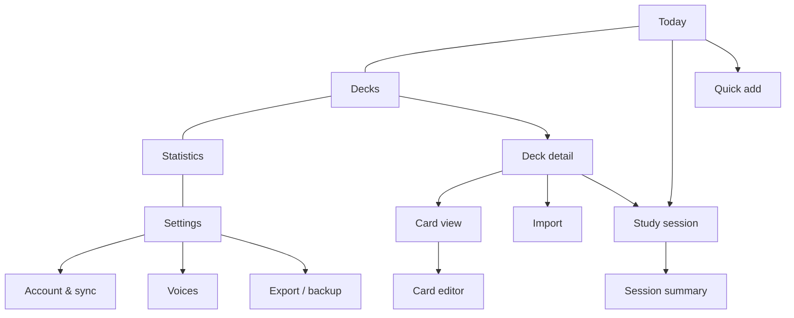

# UI / UX

This document describes the user interface of Annette Cards: design principles, navigation, every screen with
its elements and states, gestures and interaction details. Use case references (UC-xx) point to
[`use_cases.md`](use_cases.md).

## 1. Design principles

1. **Phone first, one hand.** Primary target is an iPhone in portrait. Primary actions sit in the lower half of
   the screen (thumb zone). Desktop is supported with a centered column (max width 480 px for study, 720 px for
   lists).
2. **Study in seconds.** From opening the app to the first card: one tap ("Start" on Today).
3. **Calm and focused.** During study there is no navigation chrome, only the card, progress and exit.
4. **Offline is normal.** Nothing is disabled offline except server features (audio generation, AI, sync); those
   show a small "Offline" hint instead of errors.
5. **Everything is reversible.** Undo last answer, soft delete with an undo snackbar, import preview before
   commit.
6. **Bilingual.** All text via i18n (RU/EN); layouts tolerate longer Russian strings.

## 2. Visual language

| Element | Guideline |
| --- | --- |
| Theme | Light and dark, follows system by default; manual override in Settings |
| Color | Neutral base; one accent color; semantic green (know/Good), red (don't know/Again), amber (Hard), blue (Easy) |
| Typography | System font stack (SF Pro on iOS). Card word 32–40 px, translation 22–28 px, body 16 px (never below 16 px in inputs to avoid iOS zoom) |
| Spacing | 4 px grid; touch targets ≥ 44×44 px |
| Shape | Cards with 20–24 px radius and soft shadow; buttons 12 px radius |
| Icons | lucide-react |
| Motion | Spring animations for cards; respect `prefers-reduced-motion` (fade instead of fly/tilt) |
| Safe areas | Padding with `env(safe-area-inset-*)` for notch and home indicator |

## 3. Navigation

- **Bottom tab bar** with four tabs: Today, Decks, Statistics, Settings. Hidden during study, import wizard and
  editors (full-screen flows with a back/close button).
- **Floating "+" button** on Today and Decks opens Quick add (UC-06).
- Back navigation: top-left chevron; iOS edge-swipe back works because routes are real history entries.
- Deep links: `/study?deck=<id>&mode=swipe`, `/decks/<id>`, `/cards/<id>`.

Routes (`web/src/app/router.tsx`; "full screen" = no tab bar):

| Path | Screen | Full screen |
| --- | --- | --- |
| `/` | S-04 Today | |
| `/decks`, `/decks/$deckId` | S-05 Decks list, S-06 Deck detail | |
| `/cards/$cardId` | S-07 Card view | |
| `/cards/new`, `/cards/$cardId/edit` | S-08 Card editor | yes |
| `/import` | S-10 Import wizard | yes |
| `/study?deck=&mode=` | S-11 Study session (`mode`: `swipe`, `choice`, `listening`, `typing`) | yes |
| `/study/summary` | S-12 Session summary | yes |
| `/stats` | S-13 Statistics | |
| `/settings`, `/settings/account`, `/settings/voices` | S-14 Settings, S-15 Account & sync, S-16 Voices | |
| `/welcome` | S-01 Onboarding | yes |
| `/signin?invite=`, `/register?invite=` | S-02 Sign in / Register | yes |
| `/first-sync` | S-03 First sync choice | yes |

Quick add (S-09) is a sheet over the current screen, not a route.

## 4. Global components

| Component | Behavior |
| --- | --- |
| Sync indicator | Small icon in the top bar of Today and Settings: synced ✓, syncing (spinner), pending changes (dot with count), offline (cloud-off), error (red dot → details) |
| Snackbar | Bottom, above tab bar; used for undo ("Card deleted · Undo"), success and non-blocking errors; 4 s |
| Update banner | "A new version is available · Reload" when the service worker has an update |
| Install hint | One-time sheet on iOS Safari when not installed: 3 illustrated steps "Share → Add to Home Screen" |
| Offline hint | Inline text next to server-only actions: "Available online" |
| Empty states | Illustration-free: short text + one primary action |
| Confirm sheet | iOS-style bottom sheet for destructive actions |

## 5. Screens

Each screen lists purpose, layout, elements, states and interactions.

### S-01 Welcome / Onboarding

**Purpose:** first-run setup (UC-01). Shown once per device when no local data and no account.

**Steps (horizontal pager with dots, "Next"/"Back"):**

1. **Welcome** — app name, one-line value proposition, UI language switch (RU/EN), buttons "Get started" and
   "I have an account" (→ S-02).
2. **Languages** — "I'm learning" (searchable list; EN and PL pinned at top, with locale variant chips en-GB /
   en-US) and "My language" (default Russian).
3. **Daily goal** — new words per day: 5 / 10 / 15 / 25 / custom (default 15). Short explanation of spaced
   repetition (two sentences).
4. **First deck** — "Import a file" (→ S-10), "Add words manually" (→ S-08), "Start with an empty deck".
5. **Install & persist** (iOS Safari not in standalone) — install hint; call `storage.persist()` after the user
   taps "Continue".

**States:** language list loading voices (spinner next to "Voice available" markers); no voice for the chosen
language → warning with link to iOS voice settings guide.

### S-02 Sign in / Register

**Purpose:** account access (UC-02, UC-03).

**Layout:** segmented control "Sign in" | "Register".

- Sign in: email, password (show/hide), "Sign in" button, error text under the form.
- Register: invite code (prefilled from `?invite=` link), display name, email, password with strength hint,
  "Create account".
- After success on a device with local data → S-03.

**States:** offline → form disabled with "Connect to the internet to sign in"; errors mapped from codes
(`invalid_credentials`, `invite_invalid`, `invite_expired`, `email_taken`, `rate_limited`).

### S-03 First sync choice

**Purpose:** resolve local vs server data on first sign-in (UC-04).

Shown only if both local and server data exist. Shows counts ("On this device: 2 decks, 340 cards · In your
account: 3 decks, 1 210 cards") and three options: **Merge** (recommended), **Use account data** (local data will
be removed — confirm sheet), **Cancel**. Progress view with determinate bar during initial sync.

### S-04 Today (home)

**Purpose:** daily entry point (UC-08).

**Layout (top → bottom):**

- Top bar: greeting with display name, sync indicator.
- **Hero card:** "To review: 42 · New: 15", estimated time ("≈ 9 min"), primary button **Start** (full width,
  thumb zone). If nothing is due: text "Nothing due. Next reviews in 3 h" and secondary actions "Learn extra new words", "Practice difficult words".
- Mode selector under Start (chips): Swipe (default), Choice, Listening, Typing.
- **Streak** row: flame icon, "12 days", 7-day dots.
- **Decks due** list (compact): deck name, language flag code (EN/PL), due count; tap → start session for that
  deck only.
- Floating "+" (Quick add).

**States:** first day (no reviews yet) shows only new-card count; loading skeleton for < 200 ms is avoided
(Dexie is fast) — render directly.

### S-05 Decks list

**Purpose:** manage decks (UC-05).

**Layout:** title "Decks", search field (appears on pull-down), list of deck rows:

- Name, language pair ("EN-GB → RU"), card count, progress bar (new / learning / mature), due badge.
- Swipe row left → Archive / Delete; long-press → context menu (Rename, Settings, Export, Delete).
- Every swipe/long-press action is also in the row's "⋯" menu. Archive shows a 4 s "Deck archived · Undo"
  snackbar; Export is enabled in P1-T06.
- Section "Archived" collapsed at the bottom.
- "New deck" button in the header → create deck sheet: name (required, ≤ 100 chars), target language (EN-GB, EN-US,
  PL pinned as chips, others in a picker), native language (default Russian), directions (Forward / Reverse / Both,
  default from settings), optional new-per-day override. The same sheet edits deck settings. The floating "+" on
  this screen opens Quick add (§3), not the create deck sheet.

**Empty state:** "No decks yet" + buttons "Create deck", "Import file".

### S-06 Deck detail

**Purpose:** browse and filter cards, launch deck-specific study (UC-05, UC-16).

**Layout:**

- Header: deck name, language pair, overflow menu (Deck settings, Import into deck, Export deck, Archive,
  Delete).
- Stats strip: New · Learning · Review · Difficult (lapses ≥ 3); tapping a chip filters the list.
- Buttons: **Study deck**, **Practice difficult**.
- Search (front, back, example, tags) and sort (Added ↓, Due ↑, Alphabetical, Difficulty ↓).
- Tag filter chips (horizontal scroll).
- Card list rows: front (bold), back (secondary), small speaker button, status dot (color by state), due date.
  Virtualized list for 5 000+ cards.
- Multi-select mode (long-press): move to deck, add/remove tag, reset progress, delete.

**Empty state:** "This deck is empty" + "Add word", "Import".

### S-07 Card view

**Purpose:** see everything about one card (UC-07, UC-12).

**Layout:** large front word + speaker button; IPA under it; translation; example (tap → speak) and its
translation; tags; notes. Section **Pronunciation**: current source (System voice / Generated / Recording with
attribution), buttons "Generate audio", "Find recording", "Remove audio" (server-only, offline hint).
Section **Progress** per direction: state, next due, stability, difficulty, reps, lapses, and a mini history of
the last 10 answers (colored dots). Actions: Edit, Reset progress, Delete.

### S-08 Card editor (add / edit)

**Purpose:** create or modify a card (UC-06, UC-07, UC-09).

**Fields:** Deck (picker), Front*, Back*, Example, Example translation, IPA (with helper keyboard row for common
IPA symbols), Tags (chips with autocomplete from existing tags), Notes.

- Button **"Fill with AI"** next to Front (enabled when Front is not empty and online): shows suggestions inline
  as ghost values with "Accept all" / per-field accept; never overwrites filled fields without confirmation.
- **Duplicate warning** under Front when the same normalized front exists in the deck: "Already in deck:
  *to take off — взлетать*" with link.
- Speaker button next to Front to preview pronunciation with the deck's voice.
- Save (top-right) / Cancel; "Save and add another" in add mode keeps the deck and tags.

**Validation:** Front and Back required, length limits, trimming whitespace.

### S-09 Quick add

**Purpose:** capture a word in seconds (UC-06).

Bottom sheet over the current screen: deck selector (remembers last), single field "Word or phrase", Enter →
if online and AI enabled, suggestions appear (translation + example) and one more tap saves; offline → second
field "Translation" appears. After save: snackbar "Added · Edit", field cleared, keyboard stays open.

### S-10 Import wizard

**Purpose:** import CSV/TSV (UC-10).

1. **Source:** pick file (Files app), or paste text; target deck (existing or new).
2. **Preview & mapping:** detected delimiter and encoding shown; table with first 10 rows; each column header has
   a dropdown mapped to fields (front, back, example, example_translation, ipa, tags, notes, ignore); auto-mapping
   by header names (`front`, `word`, `слово`, `back`, `translation`, `перевод`, ...). Toggle "First row is a
   header".
3. **Validation:** counts: ready / duplicates (skip, update existing, import anyway) / errors (missing front or
   back, with row numbers). Download error report.
4. **Result:** "Imported 312 cards into *English B2*", buttons "Study now", "Open deck".

Large files (10 000 rows) are parsed in a Web Worker with a progress bar.

### S-11 Study session

**Purpose:** learning and reviewing (UC-11…UC-15). Full-screen, no tab bar.

**Common layout:**

- Top: close (×) with confirm if answers were given; progress bar (done / total); counters "New 3 · Learning 2 ·
  Review 17"; undo button (↶) enabled after the first answer.
- Center: the exercise.
- Bottom: answer controls in the thumb zone.

**Start gate:** the first screen shows the deck/mode and a large **Start** button; this tap unlocks speech
synthesis on iOS.

#### Mode A — Swipe cards (default)

- Card shows the prompt: for *forward*, the studied word (+ IPA if set in settings), audio autoplay per setting;
  for *reverse*, the translation.
- **Tap** flips the card (3D flip, 250 ms) to reveal the answer, example and notes; in reverse direction audio
  plays on reveal.
- **Swipe right** = Know (Good), **swipe left** = Don't know (Again). In detailed mode **swipe up** = Easy and a
  "Hard" button is shown.
- Drag feedback: card follows the finger with rotation up to ±12°; a colored overlay and label ("Know" / "Again")
  fade in proportionally; commit threshold = 35 % of screen width or velocity > 600 px/s; otherwise spring back.
- Buttons below the card (accessible alternative): ✗ Again · (Hard) · ✓ Good · (Easy); in simple mode only ✗ and ✓.
- Swiping without flipping is allowed (fast "I know it" flow).
- Next card slides in from the stack (the next two cards are visible as a stack behind).

#### Mode B — Multiple choice

Prompt on top (word or translation), four options as large buttons. Correct → green, short delay (600 ms), next.
Wrong → chosen red, correct green, card details shown; "Continue" button. Distractors: other cards from the same
deck, preferring the same tags and similar length.

#### Mode C — Listening

Large speaker button (auto-plays), "Play slower" button (rate 0.7). Answer by choosing among four written options
(default) or by typing (setting). Result as in modes B/D.

#### Mode D — Typing

Prompt (translation in forward-recall setup), input field with auto-focus, language-appropriate keyboard hint
(`lang` attribute), "Check" button and Enter. Result:

- Correct → green, next.
- Near miss → amber, diff highlighting (missing/extra letters, missing diacritics shown as `ż`), rating Hard,
  "Continue".
- Wrong → red, correct answer shown and spoken, "Continue".
- "I don't know" link = Again.

**Session end:** automatically when the queue is empty → S-12.

**Interruptions:** leaving the app mid-session keeps all given answers (each is saved immediately); returning
within 30 min resumes the same queue.

### S-12 Session summary

Cards reviewed, accuracy %, time spent, new words learned, streak update, list of "Difficult in this session"
(Again at least once) with button **Repeat these now** (extra practice, does not affect FSRS for cards already
answered today — practice mode) and **Done**.

### S-13 Statistics

**Purpose:** progress overview (UC-19).

- Period switcher: 7 days / 30 days / 1 year; deck filter.
- Charts: reviews per day (stacked by rating), forecast of due cards for the next 30 days, card states
  distribution (new/learning/young/mature), retention (% Good+Easy for review cards), time spent per day.
- KPIs: total cards, mature cards (interval ≥ 21 d), current streak, longest streak.
- Calendar heatmap of study days (1 year view).

### S-14 Settings

Grouped list (iOS style):

- **Account & sync** → S-15.
- **Study:** new words per day, max reviews per day, directions default, answer mode (Simple 2 buttons /
  Detailed 4 buttons), show IPA on front, day starts at (hour), desired retention (slider 0.80–0.95 with hint),
  FSRS weights (Phase 4: "Optimize" button, last optimized date).
- **Audio:** autoplay (Off / Front / Front and answer), speech rate, **Voices** → S-16.
- **Reminders:** enable, time; requires installed PWA (else explanation).
- **Appearance:** theme (System / Light / Dark), UI language (Русский / English).
- **Data:** Export (JSON full backup, CSV per deck), Import backup, storage usage, "Clear cached audio".
- **About:** version, server version, licenses (including Wikimedia attributions list).

### S-15 Account & sync

Signed out: explanation "Sign in to back up and sync", buttons Sign in / Register. Signed in: display name,
email, last sync time, pending changes count, **Sync now**, sync log (last 10 runs with status), Change password,
"Sign out other devices", **Sign out** (warns about unsynced changes). Admin only: **Invites** (list with status,
create invite with note and expiry, copy link, revoke).

### S-16 Voices

Per studied language: list of available voices on this device with quality badges (Premium / Enhanced / Default),
play sample ("The quick brown fox…", "Zażółć gęślą jaźń"), select; guide "How to download better voices on
iPhone" (Settings → Accessibility → Spoken Content → Voices). Device-local setting — note: "This choice applies to
this device only".

## 6. Gestures summary

| Gesture | Where | Action |
| --- | --- | --- |
| Tap | Study card | Flip |
| Swipe right / left | Study card | Good / Again |
| Swipe up | Study card (detailed mode) | Easy |
| Tap speaker / word | Anywhere a word is shown | Speak |
| Swipe row left | Deck and card lists | Archive / Delete |
| Long-press | Lists | Context menu / multi-select |
| Pull down | Lists | Reveal search; on Today — sync now |
| Edge swipe | Navigation | Back |

## 7. Feedback, errors and edge cases

| Situation | UX |
| --- | --- |
| No voice for language | Banner on study start: "No voice for Polish installed — tap to see how to add one"; study continues silently |
| Speech blocked (no gesture yet) | Start gate prevents it; fallback: speaker icon pulses, tap to play |
| Sync conflict lost (server newer) | Silent (LWW); no dialog |
| Sync rejected rows | Settings → Sync shows an error entry with the count and "Details" |
| Storage persistence denied | Settings banner: "Your data may be removed by Safari. Sign in or export a backup." |
| Server feature offline | Button disabled with "Available online" caption |
| AI quota exceeded | Inline: "Daily AI limit reached, try tomorrow" |
| Very long text on card | Auto-shrink font down to 20 px, then scroll inside the card |
| Deleting a deck | Confirm sheet with card count; snackbar with Undo (10 s) |

## 8. Accessibility

- All swipe actions have button equivalents.
- VoiceOver labels for card sides ("Word: to take off. Double-tap to reveal translation.").
- Contrast ≥ 4.5:1; color is never the only signal (icons + text labels on overlays).
- Dynamic type: respects user font scaling up to 200 % without clipping (cards scroll).
- Reduced motion: flip and fly-out animations replaced by cross-fades.

## 9. Localization notes

- Russian plurals: "1 карточка / 2 карточки / 5 карточек" via i18next plural rules.
- Language names shown in the UI language (`Intl.DisplayNames`).
- Dates relative ("через 3 дня" / "in 3 days") via `Intl.RelativeTimeFormat`.
- Example texts in voice samples stay in the studied language.
