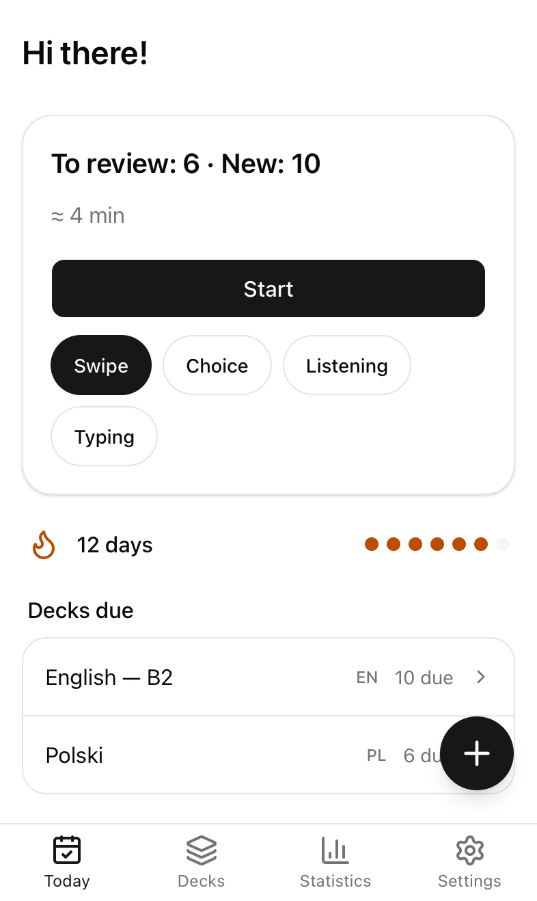
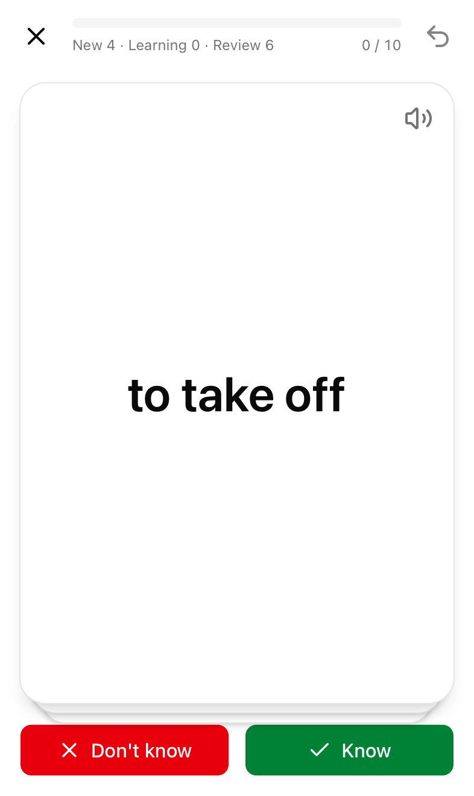
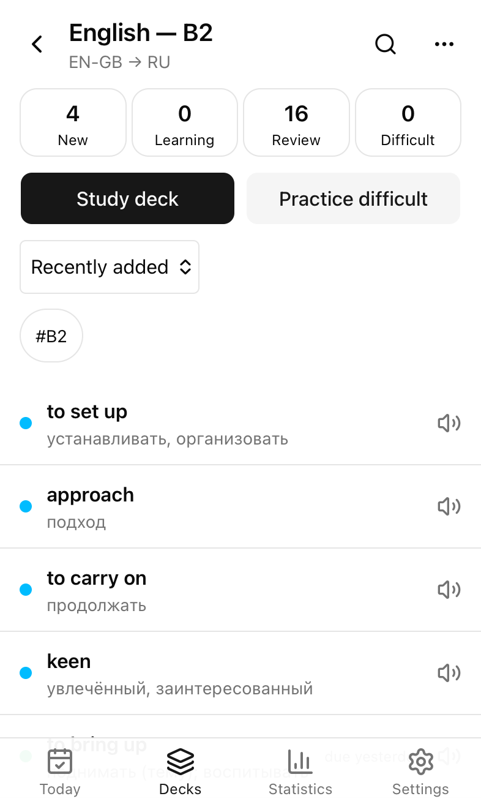
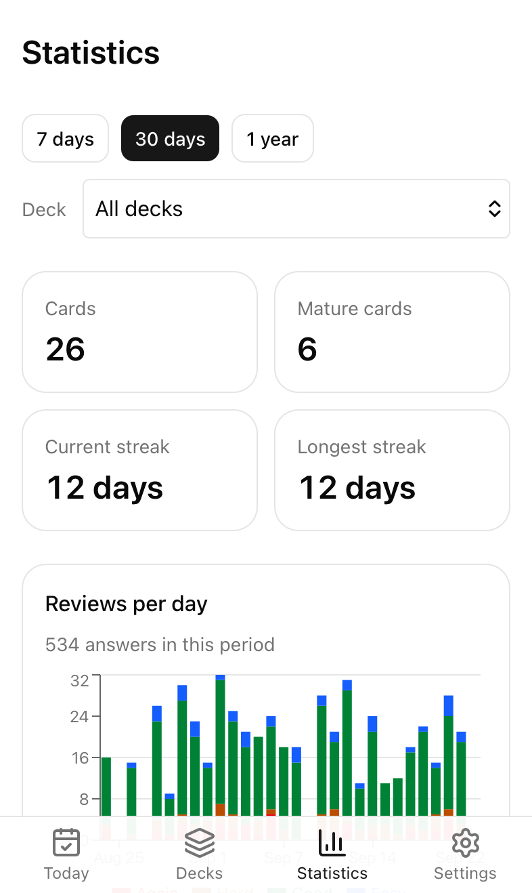

# Annette Cards — user guide

Annette Cards helps you learn words from your own lists. It shows each word again just before you would forget it
(spaced repetition, FSRS), pronounces it, and works without the internet. This guide is also available
[in Russian](ru.md).

  
  
  

## Contents

1. [Install on iPhone](#1-install-on-iphone)
2. [First run](#2-first-run)
3. [Decks and cards](#3-decks-and-cards)
4. [Importing a word list](#4-importing-a-word-list)
5. [Studying](#5-studying)
6. [Pronunciation and voices](#6-pronunciation-and-voices)
7. [Fill with AI](#7-fill-with-ai)
8. [Account and sync](#8-account-and-sync)
9. [Backups](#9-backups)
10. [Reminders](#10-reminders)
11. [Statistics and FSRS weights](#11-statistics-and-fsrs-weights)
12. [FAQ](#12-faq)

## 1. Install on iPhone

1. Open the app's address in **Safari**.
2. Tap **Share** in the Safari toolbar, then **Add to Home Screen**, then **Add**.
3. Open Annette from the Home Screen icon.

The installed app opens full screen, works offline, keeps its data safer (Safari may delete data of websites
that are not installed) and can send reminders. Settings → **Install on iPhone** shows these steps again.

## 2. First run

The first screens ask for:

- the interface language (Russian or English; change it later in Settings → Appearance);
- the language you are learning (English and Polish are at the top) and your own language;
- how many new words a day you want (15 by default);
- how to start: **Import a file**, **Add words manually** or an empty deck.

Already have an account? Tap **I have an account** on the first screen and sign in: your words come from the server.

## 3. Decks and cards

**Decks** lists your decks with their language pair, progress and how many words are due.

- **New deck**: name, the language you learn, the language of the translation, and the **directions**:
  *Forward* (see the word, recall the translation), *Reverse* (see the translation, recall the word) or *Both*
  (each direction has its own progress).
- Swipe a deck to the left to **archive** or **delete** it; the "⋯" menu has the same actions plus rename,
  settings and CSV export. Deleting can be undone for 10 seconds.

Open a deck to see its cards. The chips at the top (New, Learning, Review, Difficult) filter the list; search
finds words, translations, examples and tags; the sort menu orders by date added, due date, alphabet or
difficulty. Long-press a card to select several and move, tag, reset or delete them.

A card has a **word**, a **translation** (several meanings separated by `;`), and optionally an example with its
translation, IPA transcription, tags and notes. The editor warns when the same word is already in the deck.

**Quick add**: the round **+** button on Today and Decks. Type the word, press Enter, type the translation, press
Enter: the word is saved and the field is ready for the next one.

## 4. Importing a word list

Open a deck → "⋯" → **Import into deck** (before your first deck: Decks → **Import file**, or the first-run
screens). Choose a CSV or TSV file from Files, or paste text.

1. Choose the file and the deck to import into (or a new one).
2. Check the columns: each column gets a field (Word, Translation, Example, …, or Ignore). Headers such as
   `word`, `translation`, `слово`, `перевод` are recognized automatically.
3. Words already in the deck are **skipped** by default; you can also **update existing** cards or **import
   anyway**. Rows with errors are listed, and you can download an error report.
4. **Import**. 10 000 words take a few seconds.

The file format and all recognized headers are in the README: [Import format](../../README.md#import-format).

## 5. Studying

Tap **Start** on Today to study every deck, or open a deck and tap **Study deck**. The chips under Start choose
the mode; your choice is remembered on this device.

| Mode | How it works |
| --- | --- |
| **Swipe** | Tap the card to see the answer. Swipe **right** if you knew it, **left** if you did not. With the *Detailed* answer mode (Settings → Study) there are four buttons and swiping **up** means Easy. |
| **Choice** | Pick the right answer out of four. |
| **Listening** | Hear the word and pick it (or type it, see Settings → Study → *Listening mode answer*). **Play slower** repeats it slowly. |
| **Typing** | Type the answer. Small typos and missing accents count as **Almost** (for example `zolw` for `żółw`): the difference is highlighted. **I don't know** shows the answer. |

Choice and Listening need at least 4 different words in one language.

- **Undo** (↶ at the top right) takes back the last answer.
- Every answer is saved at once. If you leave in the middle, the session continues where you stopped when you come
  back within 30 minutes.
- At the end, the summary shows your accuracy and the words you missed; **Repeat these now** practices them
  without changing their schedule.
- **Practice difficult words** (Today or a deck) goes over words you often forget, also without changing the
  schedule.
- Nothing due? Today shows when the next reviews are and offers **Learn extra new words**.

The day starts at 4:00 by default (Settings → Study → *Day starts at*), so late-night study counts for the
previous day.

## 6. Pronunciation and voices

Tap the speaker next to a word to hear it. Settings → Audio → **Autoplay** plays words automatically.

- **System voices** are free and work offline. For better quality on iPhone, download an *Enhanced* or *Premium*
  voice in iPhone Settings → Accessibility → Spoken Content → Voices, then choose it in Annette:
  Settings → Audio → **Voices**. The voice choice applies to that device only.
- **Server audio** (signed in, if the server offers it): on a card, **Generate audio** creates a natural
  recording (it follows the IPA when the card has one), and **Find recording** looks for a native speaker's
  recording on Wikimedia Commons (English and Polish). **Remove audio** goes back to the system voice.
- **Download audio for offline** (Settings → Audio) saves the clips of your decks on this device after each sync.

## 7. Fill with AI

When you are signed in and online, **Fill with AI** in the card editor suggests the translation, an example with
its translation, the IPA and notes. Each suggestion appears under its field: tap ✓ to take it, or **Accept all**.
Quick add does the same after you press Enter, and **Save** saves the word with the suggestions. Each account can
ask for a limited number of suggestions a day.

## 8. Account and sync

Accounts are by invitation only. Ask the owner for an invite link, open it and choose **Create account**.

With an account, your words are backed up on the server and kept the same on all your devices (iPhone, laptop).
Changes made offline are sent when you are back online. Settings → **Account & sync** shows the last sync,
changes waiting to be sent, and **Sync now**; on Today, pull the screen down to sync.

- Signing in on a device that already has words asks whether to **merge** them with the account or **use the
  account data**.
- **Sign out** removes the words from this device (they stay in your account). If some changes are not sent yet,
  you are asked first.
- **Change password** signs out your other devices.

## 9. Backups

Settings → Data:

- **Export full backup**: one JSON file with all decks, cards, progress and settings. Keep it in Files or iCloud.
- **Import backup**: restore a file, either **added as new decks** or **replacing** the data on this device.
- A deck's "⋯" menu → **Export CSV** saves that deck as a table.

Without an account, export a backup now and then: it is the only copy of your words.

## 10. Reminders

Annette can remind you once a day when words are due. It needs the installed app (iOS 16.4 or later), an account
and a connection.

1. Settings → Reminders → turn on **Daily reminder** and allow notifications.
2. Choose the **Time**.

The reminder comes only when words are due and you have not studied yet that day. It says how many words wait;
tapping it opens Today. Turning the switch off stops reminders for your account. If notifications were refused,
allow them in iPhone Settings → Notifications → Annette.

## 11. Statistics and FSRS weights

**Statistics** shows, for 7 days, 30 days or a year and for one deck or all: your cards and how many are
learned well, the current and longest streak, answers per day, the reviews coming in the next 30 days, how often
you remember, and time spent. The year view has a calendar of study days.

**FSRS weights** (Settings → Study) tune the schedule to your memory. After at least 1000 answers, tap
**Optimize**: the app compares the fitted weights with the default ones and shows how much more accurate they
are. **Apply** uses them on all your devices; **Reset to default** goes back.

## 12. FAQ

**Does it work without the internet?**
Yes. Studying, adding and editing words, import, statistics and system voices all work offline. Signing in, sync,
server audio, AI suggestions and FSRS optimization need a connection.

**Is my data safe?**
Your words are stored on the device. With an account they are also on the server, which is backed up
continuously. Without an account, install the app to the Home Screen and export backups; Annette warns you when
Safari may remove its data.

**I deleted something by mistake.**
Use **Undo** in the message that appears right after deleting. Deleted words are kept for 90 days on the server
before they are removed for good.

**A device was offline for months.**
Sign out and sign in again on that device, so it takes the account's current data.

**Why do I see a word I just answered?**
New and forgotten words come back after a short learning step in the same session.

**Where do the recordings come from?**
From Wikimedia Commons; the author and license of each saved recording are in Settings → About → Recordings.
