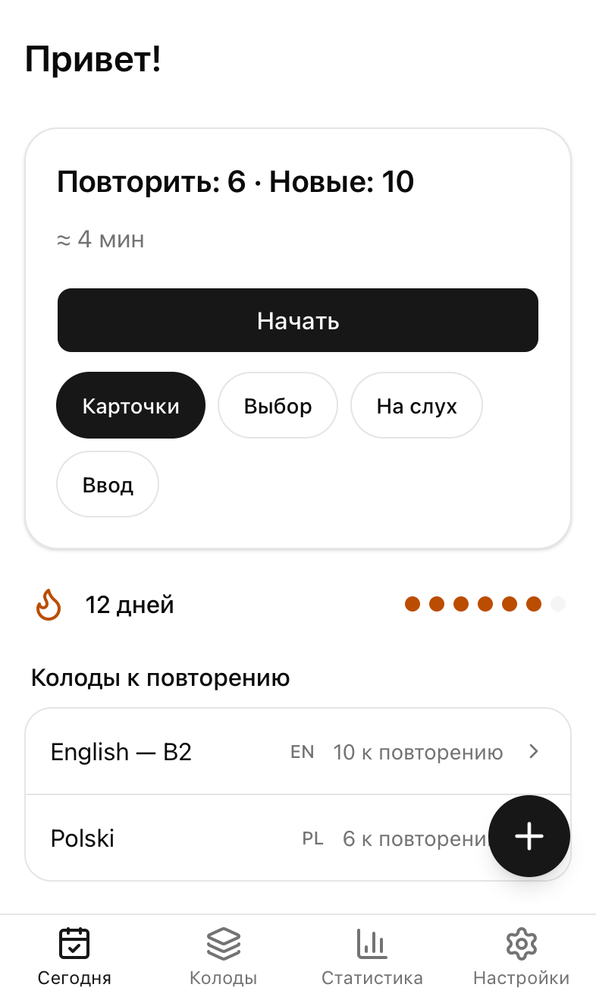
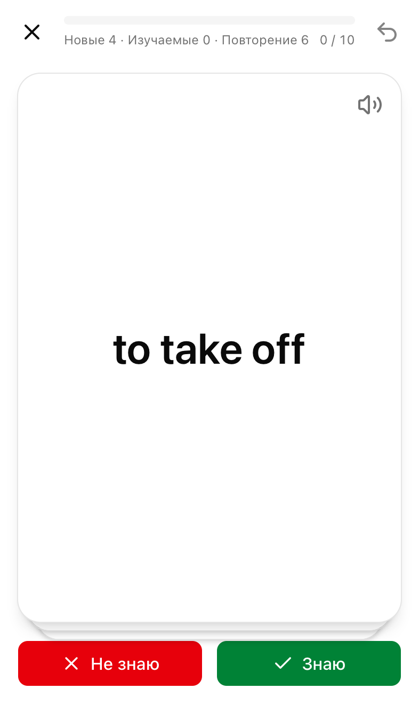
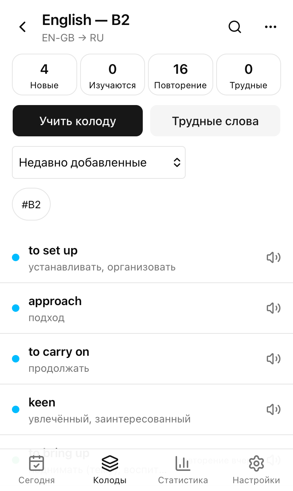
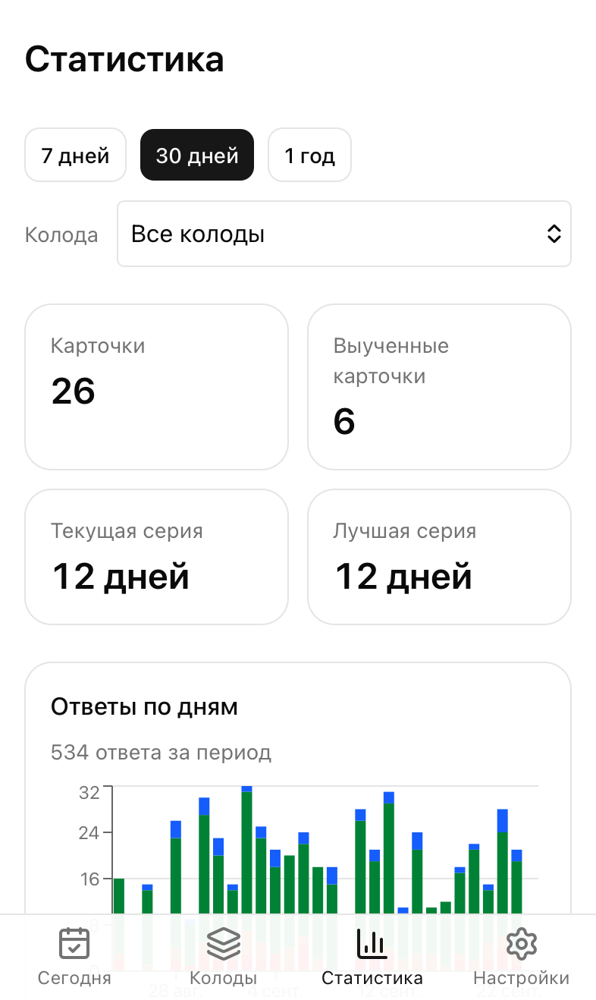

# Annette Cards — руководство пользователя

Annette Cards помогает учить слова из ваших собственных списков. Приложение показывает слово снова как раз тогда,
когда вы начинаете его забывать (интервальное повторение, FSRS), произносит его и работает без интернета.
Руководство есть и [на английском](en.md).

  
  
  

## Содержание

1. [Установка на iPhone](#1-установка-на-iphone)
2. [Первый запуск](#2-первый-запуск)
3. [Колоды и карточки](#3-колоды-и-карточки)
4. [Импорт списка слов](#4-импорт-списка-слов)
5. [Занятия](#5-занятия)
6. [Произношение и голоса](#6-произношение-и-голоса)
7. [Заполнение с ИИ](#7-заполнение-с-ии)
8. [Аккаунт и синхронизация](#8-аккаунт-и-синхронизация)
9. [Резервные копии](#9-резервные-копии)
10. [Напоминания](#10-напоминания)
11. [Статистика и веса FSRS](#11-статистика-и-веса-fsrs)
12. [Вопросы и ответы](#12-вопросы-и-ответы)

## 1. Установка на iPhone

1. Откройте адрес приложения в **Safari**.
2. Нажмите **Поделиться** на панели Safari, затем **На экран «Домой»**, затем **Добавить**.
3. Открывайте Annette значком на экране «Домой».

Установленное приложение открывается на весь экран, работает без сети, надёжнее хранит данные (Safari может удалить
данные сайтов, которые не установлены) и умеет присылать напоминания. Настройки → **Установить на iPhone**
показывает эти шаги ещё раз.

## 2. Первый запуск

На первых экранах приложение спросит:

- язык интерфейса (русский или английский; потом его можно сменить в Настройки → Оформление);
- язык, который вы учите (английский и польский — вверху списка), и ваш родной язык;
- сколько новых слов в день вы хотите учить (по умолчанию 15);
- с чего начать: **Импортировать файл**, **Добавить слова вручную** или пустая колода.

Уже есть аккаунт? Нажмите **У меня есть аккаунт** на первом экране и войдите: слова загрузятся с сервера.

## 3. Колоды и карточки

На вкладке **Колоды** — ваши колоды с парой языков, прогрессом и числом слов к повторению.

- **Новая колода**: название, язык, который вы учите, язык перевода и **направления**: *Прямое* (видите слово —
  вспоминаете перевод), *Обратное* (видите перевод — вспоминаете слово) или *Оба* (у каждого направления свой
  прогресс).
- Смахните колоду влево, чтобы **архивировать** или **удалить** её; в меню «⋯» те же действия, а также
  переименование, настройки и экспорт в CSV. Удаление можно отменить в течение 10 секунд.

Откройте колоду, чтобы увидеть её карточки. Кнопки вверху (Новые, Изучаются, Повторение, Трудные) фильтруют
список; поиск находит слова, переводы, примеры и теги; сортировка — по дате добавления, дате повторения, алфавиту
или трудности. Долгое нажатие на карточку включает выбор нескольких: их можно перенести, пометить тегом, сбросить
прогресс или удалить.

У карточки есть **слово**, **перевод** (несколько значений через `;`) и, по желанию, пример с переводом,
транскрипция, теги и заметки. Редактор предупреждает, если такое слово уже есть в колоде.

**Быстрое добавление**: круглая кнопка **+** на экранах «Сегодня» и «Колоды». Введите слово, нажмите Enter,
введите перевод, снова Enter — слово сохранено, и можно вводить следующее.

## 4. Импорт списка слов

Откройте колоду → «⋯» → **Импорт в колоду** (пока колод нет: Колоды → **Импорт из файла** или экраны первого
запуска). Выберите файл CSV или TSV в «Файлах» или вставьте текст.

1. Выберите файл и колоду для импорта (или создайте новую).
2. Проверьте столбцы: каждому назначается поле (Слово, Перевод, Пример, … или Пропустить). Заголовки вроде
   `слово`, `перевод`, `word`, `translation` распознаются сами.
3. Слова, которые уже есть в колоде, по умолчанию **пропускаются**; можно также **обновить существующие**
   карточки или **всё равно импортировать**. Строки с ошибками показаны списком, отчёт об ошибках можно скачать.
4. **Импортировать**. 10 000 слов занимают несколько секунд.

Формат файла и все распознаваемые заголовки описаны в README: [Import format](../../README.md#import-format).

## 5. Занятия

Нажмите **Начать** на экране «Сегодня», чтобы заниматься по всем колодам, или откройте колоду и нажмите
**Учить колоду**. Кнопки под «Начать» выбирают режим; выбор запоминается на этом устройстве.

| Режим | Как устроен |
| --- | --- |
| **Карточки** | Нажмите на карточку, чтобы увидеть ответ. Смахните **вправо**, если знали, **влево** — если нет. В *подробном* режиме ответа (Настройки → Обучение) кнопок четыре, а смахивание **вверх** означает «Легко». |
| **Выбор** | Выберите правильный ответ из четырёх. |
| **На слух** | Послушайте слово и выберите его (или введите — см. Настройки → Обучение → *Ответ в режиме «На слух»*). **Медленнее** повторяет слово медленно. |
| **Ввод** | Введите ответ. Мелкие опечатки и пропущенные диакритические знаки засчитываются как **Почти** (например, `zolw` вместо `żółw`), а разница подсвечивается. **Не знаю** показывает ответ. |

Для режимов «Выбор» и «На слух» нужно хотя бы 4 разных слова на одном языке.

- **Отмена** (↶ справа вверху) отменяет последний ответ.
- Каждый ответ сохраняется сразу. Если выйти посередине и вернуться в течение 30 минут, занятие продолжится с
  того же места.
- В конце итог показывает точность и слова, которые вы не вспомнили; **Повторить их сейчас** тренирует их, не меняя
  расписание.
- **Трудные слова** (на экране «Сегодня» или в колоде) — тренировка слов, которые вы часто забываете, тоже без
  изменения расписания.
- Нечего повторять? «Сегодня» покажет, когда будут следующие повторения, и предложит **Выучить ещё новые слова**.

По умолчанию день начинается в 4:00 (Настройки → Обучение → *День начинается в*), так что занятие поздно ночью
засчитывается в предыдущий день.

## 6. Произношение и голоса

Нажмите на значок динамика рядом со словом, чтобы услышать его. Настройки → Звук → **Автовоспроизведение**
произносит слова автоматически.

- **Системные голоса** бесплатны и работают без сети. Для лучшего качества на iPhone скачайте *улучшенный* или
  *премиум*-голос в Настройки iPhone → Универсальный доступ → Устный контент → Голоса и выберите его в Annette:
  Настройки → Звук → **Голоса**. Выбор голоса действует только на этом устройстве.
- **Аудио с сервера** (после входа, если сервер это поддерживает): на карточке **Сгенерировать аудио** создаёт
  естественное произношение (с учётом транскрипции, если она есть), а **Найти запись** ищет запись носителя языка
  на Wikimedia Commons (английский и польский). **Удалить аудио** возвращает системный голос.
- **Скачивать аудио для офлайна** (Настройки → Звук) сохраняет записи ваших колод на этом устройстве после каждой
  синхронизации.

## 7. Заполнение с ИИ

Когда вы вошли в аккаунт и есть сеть, кнопка **Заполнить с ИИ** в редакторе карточки предлагает перевод, пример
с переводом, транскрипцию и заметки. Каждая подсказка появляется под своим полем: нажмите ✓, чтобы принять её, или
**Принять все**. Быстрое добавление делает то же после нажатия Enter, а **Сохранить** сохраняет слово вместе с
подсказками. Число подсказок в день для каждого аккаунта ограничено.

## 8. Аккаунт и синхронизация

Аккаунты создаются только по приглашению. Попросите у владельца ссылку-приглашение, откройте её и нажмите
**Создать аккаунт**.

С аккаунтом ваши слова хранятся и на сервере и одинаковы на всех ваших устройствах (iPhone, ноутбук). Изменения,
сделанные без сети, отправляются, когда сеть появится. Настройки → **Аккаунт и синхронизация** показывает время
последней синхронизации, неотправленные изменения и кнопку **Синхронизировать**; на экране «Сегодня» потяните
экран вниз, чтобы синхронизировать.

- При входе на устройстве, где уже есть слова, приложение спросит: **объединить** их с аккаунтом или
  **использовать данные аккаунта**.
- **Выйти** удаляет слова с этого устройства (в аккаунте они остаются). Если какие-то изменения ещё не
  отправлены, приложение сначала спросит.
- **Сменить пароль** — на других устройствах нужно будет войти заново.

## 9. Резервные копии

Настройки → Данные:

- **Экспорт полной копии** — один файл JSON со всеми колодами, карточками, прогрессом и настройками. Храните его
  в «Файлах» или iCloud.
- **Импорт копии** — восстановление из файла: **добавить как новые колоды** или **заменить данные на
  устройстве**.
- Меню колоды «⋯» → **Экспорт CSV** сохраняет колоду таблицей.

Без аккаунта время от времени делайте резервную копию: это единственная копия ваших слов.

## 10. Напоминания

Annette может раз в день напоминать, что пора повторить слова. Нужны установленное приложение (iOS 16.4 или
новее), аккаунт и сеть.

1. Настройки → Напоминания → включите **Ежедневное напоминание** и разрешите уведомления.
2. Выберите **Время**.

Напоминание приходит, только если есть слова к повторению и вы ещё не занимались в этот день. В нём сказано,
сколько слов ждёт; нажатие открывает «Сегодня». Выключение переключателя отключает напоминания для всего аккаунта.
Если уведомления запрещены, разрешите их в Настройки iPhone → Уведомления → Annette.

## 11. Статистика и веса FSRS

**Статистика** показывает за 7 дней, 30 дней или год, по одной колоде или по всем: число карточек и сколько из них
хорошо выучено, текущую и лучшую серию, ответы по дням, повторения на ближайшие 30 дней, как часто вы вспоминаете
слово и сколько времени занимались. В режиме «1 год» есть календарь дней занятий.

**Веса FSRS** (Настройки → Обучение) подстраивают расписание под вашу память. После 1000 ответов нажмите
**Оптимизировать**: приложение сравнит подобранные веса с весами по умолчанию и покажет, насколько они точнее.
**Применить** включает их на всех ваших устройствах; **Вернуть по умолчанию** — возврат к исходным.

## 12. Вопросы и ответы

**Работает ли приложение без интернета?**
Да. Занятия, добавление и правка слов, импорт, статистика и системные голоса работают без сети. Для входа,
синхронизации, аудио с сервера, подсказок ИИ и оптимизации FSRS нужна сеть.

**Сохранны ли мои данные?**
Слова хранятся на устройстве. С аккаунтом они есть и на сервере, у которого постоянно делается резервная копия.
Без аккаунта установите приложение на экран «Домой» и делайте резервные копии; Annette предупредит, если Safari
может удалить её данные.

**Я случайно что-то удалил(а).**
Нажмите **Отменить** в сообщении, которое появляется сразу после удаления. Удалённые слова хранятся на сервере
90 дней, потом удаляются окончательно.

**Устройство было без сети несколько месяцев.**
Выйдите из аккаунта на этом устройстве и войдите снова — оно получит актуальные данные аккаунта.

**Почему слово, на которое я только что ответил(а), появилось снова?**
Новые и забытые слова возвращаются в том же занятии после короткого шага заучивания.

**Откуда берутся записи произношения?**
С Wikimedia Commons; автор и лицензия каждой сохранённой записи — в Настройки → О приложении → Записи.
